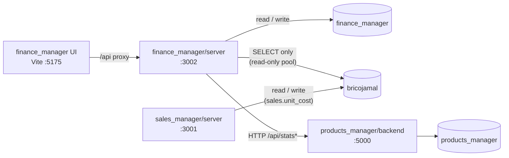

# Finances — Expenses & Profit: Plan

Request: "I will enter my expenses (rent, water, electricity, food, ...) and of course the daily sales.
The system calculates the profits and expenses per month and per year. Add anything I missed."

Status: **Chunk 1 done (2026-11-19)**, inside `sales_manager`. All questions answered on 2026-11-19 (§11, decisions 13–20 in §4).

Added 2026-11-20: "Move *Valeur du Stock*, *Argent dépensé en achats* and *Valeur du stock (prix d'achat)* from
`products_manager` to Finances." Plan only: decision 21 (§4), §8.1, Chunk 6b (§10), questions 9–12 (§11).

**Changed 2026-11-20: Finances becomes its own app, `finance_manager` (option C, §1).** The user asked for it, and
chose to have it read the sales database directly. Decisions 26–33 (§4), questions 13–15 (§11).
Plan only, no code yet. **Waiting for the user's review.**
Next after the go: Chunk 1b (split Chunk 1), then Chunk 1c (scaffold `finance_manager`).

---

## 1. Where to build it

| Option | Good | Bad |
| --- | --- | --- |
| **A. New "Finances" module in `sales_manager`** | The daily sales are already here (`bricojamal.sales`, written by QR Sale + manual sale form). The other money screens live here too: customer credit, supplier ledger, Carnet, invoices, Reports. Same stack and patterns (`ensure*Tables()`, `addColumnIfMissing`, `app_settings`, fr/ar locales). `recharts` and `xlsx` are already installed. | Needs the purchase price from `products_manager` (one small, additive change, see §5). |
| B. Inside `products_manager` | Has the purchase prices and the stock "Spending" report. | It's a catalogue / stock tool. It has no daily sales screen, and its own `sales` table only holds catalogue lines: lines typed by hand are missing. Rent and electricity aren't products. |
| C. New third app (`finance_manager`) | Clean separation. | A 3rd frontend, a 3rd API and a 3rd database, so 5+ processes to run. Theme, i18n and nav would all be copied. Every report would need HTTP calls to both other apps. Only worth it for several shops or a separate accountant login. |

~~Decision: option A~~ (2026-11-19, replaced).

**Decision (2026-11-20): option C.** Finances is a third app, `finance_manager`, at the repo root next to the other two.
The user asked for it. The costs in the table above are accepted: a 3rd frontend, API and database, 7 processes in the
root `dev` script (§1.2), and copied theme / i18n / nav.

| Part | `finance_manager` |
| --- | --- |
| Frontend | `finance_manager/` — React 18 (JSX) + Vite 6 + Tailwind 3 + i18next, same stack as `sales_manager`. Port **5175** |
| API | `finance_manager/server/` — Express + mysql2. Port **3002** |
| Own database | `finance_manager` (created on start if missing, like `bricojamal`): expense tables, cash closings, settings (§5) |
| Sales data | **Read directly** from `bricojamal` through a second, **read-only** pool (§1.1). Nothing is ever written there |
| Stock data | Over HTTP from `products_manager` `GET /api/stats*` (decision 21, unchanged) |



> Revenue always comes from `bricojamal.sales`, the sales_manager table. Do **not** add `products_manager.sales`
> on top of it: that table is a partial mirror of the same tickets and would double the revenue.

### 1.1 How `finance_manager` reads the sales

Chosen on 2026-11-20 over an HTTP endpoint on `sales_manager`: it is simpler, needs no new sales API, and the cash view
(Chunk 11) also needs `customer_payments` and `supplier_transactions`, which a direct read gives for free.

- **Second pool, read-only.** `finance_manager/server/config/salesDatabase.js` opens a pool on `bricojamal` with its own
  `SALES_DB_*` settings (they fall back to `DB_*`, so dev works with the same root user). Every connection runs
  `SET SESSION TRANSACTION READ ONLY`, so a bug can never write to the sales. In production, use a MySQL user with
  `GRANT SELECT ON bricojamal.*` only (question 14).
- **What it reads (and nothing else):**

  | Table | Columns | Used by |
  | --- | --- | --- |
  | `sales` | `id`, `date`, `product_id`, `productName`, `category`, `quantity`, `totalPrice`, `payment_method`, `customer_id`, `unit_cost`, `cost_source`, `updated_at` | Revenue, cost of goods sold, margins by category, daily closing |
  | `customer_payments` | `amount`, `payment_date`, `payment_method` | Daily closing, cash view |
  | `supplier_transactions` | `type`, `amount`, `transaction_date`, `payment_method` | Cash view (supplier payments only, §12) |

- **One file knows the sales schema:** `finance_manager/server/models/SalesSource.js`. All the SQL against `bricojamal`
  lives there, so a column rename in `sales_manager` only touches that file.
- **No cross-database JOIN.** Sales totals (sales pool) and expense totals (finance pool) are fetched separately and combined
  in JS. The two databases can then live on different MySQL servers.
- **Sales database down or wrong credentials:** the API still starts. Sales-based numbers come back as
  `{ sales_available: false }` with HTTP 200, the UI shows "Ventes indisponibles" + **Réessayer**, and expenses keep working.
- **`unit_cost` not there yet** (real DB before Chunk 2 / 1b has run): `SalesSource` checks the column once at start-up.
  If it's missing, every line counts as unknown cost (estimated with the default margin) instead of failing with an SQL error.
- **The cost columns stay owned by `sales_manager`.** `finance_manager` never creates or alters anything in `bricojamal`.

### 1.2 What changes in the other two apps

| App | Change |
| --- | --- |
| `sales_manager` | Keeps only the sale cost part of Chunk 1 (`sales.unit_cost`, `cost_source`, `idx_sales_date`), Chunk 2 (cost at checkout) and Chunk 3 (backfill script, it writes to `sales`). Gets a **"Finances" link** in `Navigation.jsx` that opens the finance app (`VITE_FINANCE_URL`, default `http://localhost:5175`). `Inventory.jsx` loses its 2 money cards (decision 24). No finance route, model or screen |
| `products_manager` | Chunk 2 (integration returns `unit_cost`) and Chunk 6b (the money cards are removed). Its `/api/stats*` endpoints stay as they are |
| Root `package.json` | `dev` also starts `cd finance_manager && bun run dev` (API + frontend). Total: products 2 + sales 3 + finance 2 = **7 processes** |
| `README.md` | Third app in the overview, the diagram, the ports table (5175 / 3002) and the environment variables |

---

## 2. The key idea: real profit is not "sales − expenses"

If profit = sales − rent − electricity, the result looks huge, because the shop also paid for the goods it sold.
The real calculation has 3 levels:

```text
  Revenue (Chiffre d'affaires)            what customers paid        sales.totalPrice
- Cost of goods sold (Coût d'achat)       what those items cost you  sales.quantity x sales.unit_cost
= GROSS MARGIN (Marge brute)
- Business expenses (Charges)             rent, water, electricity, salaries, transport...
= NET PROFIT (Bénéfice net)
- Personal withdrawals (Prélèvements)     home, family... (money taken out of the shop for you)
= LEFT OVER (Reste)
```

### Worked example: November 2026

| Line | Amount |
| --- | ---: |
| Revenue | 48 000 DH |
| Cost of goods sold (70 %) | − 33 600 DH |
| **Gross margin (30 %)** | **14 400 DH** |
| Rent 3 000 · Electricity 450 · Water 120 · Internet 300 · Transport 600 · Helper's salary 2 500 · Misc 200 | − 7 170 DH |
| **Net profit** | **7 230 DH** |
| Home / family (personal) | − 2 000 DH |
| **Left over** | **5 230 DH** |

### Why restocking is NOT an expense here

Example: you buy 10 paint pots at 50 DH (500 DH) in November and sell 2 of them at 80 DH.
- November's cost is 2 x 50 = **100 DH**, not 500 DH. The 8 pots left are still worth 400 DH on the shelf.
- If the 500 DH were counted as an expense, November would show a fake loss and the next months a fake profit.
- Restocks are still visible elsewhere: in the **cash view** (§3), in the supplier ledger, and in the
  "Argent dépensé en achats" card + monthly report, which move from `products_manager` to Finances (§8.1).

The same rule applies to the **Carnet**: money lent to a person isn't a cost. It stays out of profit.

---

## 3. Two views: Profit and Cash

| | Profit view (Bénéfice) — the default | Cash view (Trésorerie) |
| --- | --- | --- |
| Question it answers | "Is the shop making money?" | "Where did the cash go?" |
| Money in | All sales on their sale date (credit sales included) | Non-credit sales + customer payments received |
| Money out | Cost of goods sold + business expenses for the month (paid **and** still to pay) | Expenses actually paid + supplier payments (`supplier_transactions.type = 'payment'`) |
| Personal expenses | Shown below the net profit, as withdrawals | Counted as money out |

---

## 4. Decisions

1. ~~**Module lives in `sales_manager`**~~ → replaced by decision 26 (own app). The FR label "Finances" and AR "المالية"
   are kept, for the app title and the link in the `sales_manager` nav.
2. **Every sale line remembers its cost.** New column `sales.unit_cost`, filled at checkout with the product's
   purchase price *at that moment*. Later purchase price edits never rewrite past profits.
3. **Old sales get a cost once, from a script** (§5.3). It uses the purchase price history when it exists. Lines with no
   product (typed by hand) keep `unit_cost = NULL`.
4. **Unknown cost = estimated**, using a default margin setting (30 % by default). The overview always shows the
   coverage ("Coût connu pour 96 % du CA") so the number is never silently wrong.
5. **Expenses belong to a month (`period_month`)**, which can differ from the day they were paid. Example: the October
   electricity bill paid on 5 November counts for October. It defaults to the month of the payment date.
6. **Big yearly costs can be spread** over several months (`spread_months`). For example, a 1 200 DH yearly tax becomes 12 x 100 DH, so one month
   doesn't look like a disaster.
7. **Categories can be marked "personal"** (only home by default; food is a business expense, §4 #19). They appear as
   withdrawals, not as business expenses. Each category can be switched.
8. **Restocks, supplier payments and Carnet loans are never business expenses** (§2). They only appear in the cash view.
9. **Pending bills count in the month's profit** (the cost is real) but are flagged "à payer". The cash view only counts paid ones.
10. **Only PUT, no PATCH.** The server CORS config only allows `GET, POST, PUT, DELETE`. Example: "mark as paid" is
    `PUT /api/expenses/:id/pay`.
11. **Controllers send their own error status.** `errorHandler.js` ignores `err.status`, as already noted in todos.
12. **Money is DECIMAL in SQL** and rounded with `round2` in JS, the same as the rest of the app. The UI shows MAD with
    `Intl.NumberFormat('fr-MA')`, the same as the Dashboard.

From the answers (2026-11-19, §11):

13. **PIN lock moves to Phase 1** (Q2: other people use the computer). The whole `finance_manager` UI stays hidden
    until the PIN is typed (the `sales_manager` Dashboard widget is dropped, decision 32). It's built in Chunk 6, not Chunk 12.
14. **No "sales not entered" field** (Q3: every sale is entered). Revenue = `bricojamal.sales` only. The
    `unrecorded_sales` column and its formula terms are removed.
15. **Default margin stays at 30 %** (Q5: not important). It's only shown in the settings dialog, not on the main screens.
16. **The shop is open every day** (Q7). Break-even per day = break-even / number of days in the month (28–31).
    The `finance.open_days_per_month` setting is removed.
17. **Every expense is paid from the shop's till** (Q8). `paid_from` stays in the table (default `'till'`) but is
    hidden in the UI. The daily closing counts every paid expense of the day as money out of the till.
18. **Recurring bills are seeded** (Q6): Loyer 5 000 DH / month and Internet 200 DH / month, both due on the **10th**
    (§5.6). No salary was given, so no salary bill is created (the category still exists).
19. **Food is a business expense** (Q1: meals at the shop). The `food` category is seeded with `is_personal = 0`
    and named "Repas au magasin" / "الأكل في المحل". It lowers the net profit like electricity does.
20. **Past sales get their cost from the price history** (Q4: option A). The Chunk 3 backfill script runs as planned
    (§5.3): purchase price on the sale date, falling back to the current purchase price.

From the request of 2026-11-20:

21. **The stock money cards move from `products_manager` to Finances** (§8.1, Chunk 6b). They are "Valeur du Stock",
    "Valeur du stock (prix d'achat)" and "Argent dépensé en achats", plus its monthly report.
    - **The data stays where it is.** `products`, `stock_purchases` and the endpoints `GET /api/stats`,
      `/api/stats/spending` and `/api/stats/spending/entries` stay in `products_manager` without changes.
      The sales_manager server reads them over HTTP (`PRODUCTS_API_URL`, the same way `salesController` does).
      So sales_manager still never needs the `products_manager` database credentials (§5.3).
    - **Finances shows them behind the PIN** (§4 #13). Today anyone at the computer can see them on the
      products_manager home page.
    - **They are removed from `products_manager` only once Finances shows them**, so the numbers are never missing.
    - **Purchases are still not an expense** (§2). The card says so, and it never enters the profit formulas (§6).

From the answers of 2026-11-20 (§11, questions 9–12, all defaults):

22. **Move, not copy** (Q9). Once Finances shows them, the 3 cards and the monthly report are removed from `products_manager`.
23. **The per-page "Valeur du stock - Page N" card is removed too** (Q10), in the same chunk.
24. **The sales_manager `Inventory.jsx` "Valeur du Stock" and "Valeur de Coût" cards are removed** (Q11), in the same chunk.
25. **"Marge potentielle en stock" is shown** (Q12): sale value − cost value, a small line under "Valeur du stock (prix d'achat)".

From the request of 2026-11-20, "Finances as its own app" (§1, option C):

26. **Finances is its own app, `finance_manager`:** frontend :5175, API :3002, database `finance_manager` (§1).
27. **The expense tables live in the `finance_manager` database**, not in `bricojamal`: `expense_categories`, `expenses`,
    `expense_allocations`, `recurring_expenses`, `cash_closings`, plus its own `app_settings` (PIN, default margin).
    Chunk 1 is split (Chunk 1b). Nothing ever ran on a real MySQL, so there is no data to move.
28. **Sales are read directly from `bricojamal`** through a second, read-only pool (§1.1). Not over HTTP.
29. **`sales_manager` keeps only the sale cost columns** (`unit_cost`, `cost_source`, `idx_sales_date`), Chunk 2 and the
    Chunk 3 backfill script. It gets no finance route, model or screen.
30. **Stock and purchase numbers still come over HTTP from `products_manager`** (decision 21). Only the caller changes:
    the proxies are in the `finance_manager` API.
31. **Look and languages are copied from `sales_manager`**: same Tailwind / shadcn tokens, dark mode, fr + ar with RTL.
    `finance_manager` gets its own accent colour, so you can tell the apps apart at a glance. It has its own small
    `fr.json` / `ar.json` (only `finance.*` + `common.*` keys), not a copy of the 1 400-line sales files.
32. **The `sales_manager` Dashboard `FinanceWidget` is dropped** (question 13, default). The money numbers stay behind the
    finance PIN. `sales_manager` only gets a "Finances" nav link (§1.2), and the finance overview shows "today's sales" instead.
33. **Fixing an unknown-cost sale line happens in `sales_manager`.** `finance_manager` is read-only on sales. The
    "unknown cost lines" list shows the ticket and the date, and links to the sales history in the sales app.

---

## 5. Data model

Two databases, two owners (decisions 27–29):

| Where | What | Created by |
| --- | --- | --- |
| `finance_manager` database (new) | §5.1 tables, §5.4 category seed, §5.5 settings, §5.6 recurring seed | `ensureFinanceTables(pool)` in `finance_manager/server/config/financeSchema.js`, run on every API start after `CREATE DATABASE IF NOT EXISTS finance_manager` |
| `bricojamal` (existing) | §5.2 sale cost columns + index | `ensureSaleCostColumns(pool)` in `sales_manager/server/config/saleCostSchema.js`, called from `database.js` where `ensureFinanceTables` is called today |

Both functions keep the Chunk 1 rules: idempotent, take the pool as an argument (testable with a fake pool), log each
failing step and never throw, so the API always starts.

**Chunk 1b split of today's `sales_manager/server/config/financeSchema.js`:**
- Steps 1–2 (tables + category seed) and `FINANCE_SEED_CATEGORIES` / `FINANCE_TABLES` → `finance_manager/server/config/financeSchema.js`.
- Steps 3–4 (`SALES_COST_COLUMNS`, `columnExists`, `salesDateIndexExists`) → `sales_manager/server/config/saleCostSchema.js`.
- `sales_manager/server/config/financeSchema.js` is deleted and the import in `database.js` is renamed.
- No cross-database foreign keys. Inside `finance_manager` there are none either (§5.1 comment, unchanged).

### 5.1 New tables (in the `finance_manager` database)

```sql
CREATE TABLE IF NOT EXISTS expense_categories (
  id INT AUTO_INCREMENT PRIMARY KEY,
  code VARCHAR(40) NULL UNIQUE,              -- seed key (rent, water...), NULL for user categories
  name_fr VARCHAR(100) NOT NULL,
  name_ar VARCHAR(100) NOT NULL,
  icon VARCHAR(40) NULL,                     -- lucide icon name
  color VARCHAR(20) NULL,
  is_personal TINYINT(1) NOT NULL DEFAULT 0, -- 1 = personal withdrawal, not a business expense
  is_fixed TINYINT(1) NOT NULL DEFAULT 0,    -- used by the break-even point
  monthly_budget DECIMAL(12,2) NULL,
  sort_order INT NOT NULL DEFAULT 0,
  archived TINYINT(1) NOT NULL DEFAULT 0,
  created_at TIMESTAMP DEFAULT CURRENT_TIMESTAMP,
  updated_at TIMESTAMP DEFAULT CURRENT_TIMESTAMP ON UPDATE CURRENT_TIMESTAMP
);

CREATE TABLE IF NOT EXISTS expenses (
  id INT AUTO_INCREMENT PRIMARY KEY,
  category_id INT NOT NULL,
  amount DECIMAL(12,2) NOT NULL CHECK (amount > 0),
  expense_date DATE NOT NULL,                -- day it was paid / spent
  period_month CHAR(7) NOT NULL,             -- '2026-10': month the cost belongs to
  spread_months TINYINT NOT NULL DEFAULT 1,  -- 12 = spread over 12 months from period_month
  status ENUM('paid','pending') NOT NULL DEFAULT 'paid',
  due_date DATE NULL,
  paid_from ENUM('till','bank','pocket') NOT NULL DEFAULT 'till',  -- hidden in the UI: always the till (§4 #17)
  payee VARCHAR(150) NULL,                   -- "Lydec", "Propriétaire"...
  reference VARCHAR(100) NULL,               -- bill number
  description VARCHAR(255) NULL,
  notes TEXT NULL,
  attachment_url VARCHAR(500) NULL,          -- photo of the bill
  recurring_id INT NULL,
  deleted_at DATETIME NULL,                  -- soft delete (undo)
  created_at TIMESTAMP DEFAULT CURRENT_TIMESTAMP,
  updated_at TIMESTAMP DEFAULT CURRENT_TIMESTAMP ON UPDATE CURRENT_TIMESTAMP,
  INDEX idx_expenses_period (period_month),
  INDEX idx_expenses_date (expense_date),
  INDEX idx_expenses_category (category_id),
  INDEX idx_expenses_status (status)
);

-- One row per month an expense counts in (1 row, or N rows when spread). Rewritten in the same
-- transaction as every expense create / update / delete, so monthly reports are a simple SUM.
CREATE TABLE IF NOT EXISTS expense_allocations (
  expense_id INT NOT NULL,
  period_month CHAR(7) NOT NULL,
  amount DECIMAL(12,2) NOT NULL,             -- last month gets the leftover cents
  PRIMARY KEY (expense_id, period_month),
  INDEX idx_expense_alloc_period (period_month)
);

CREATE TABLE IF NOT EXISTS recurring_expenses (
  id INT AUTO_INCREMENT PRIMARY KEY,
  category_id INT NOT NULL,
  label VARCHAR(150) NOT NULL,               -- "Loyer magasin"
  amount DECIMAL(12,2) NOT NULL,
  amount_is_estimate TINYINT(1) NOT NULL DEFAULT 0,  -- water / electricity: real amount typed when paid
  frequency ENUM('monthly','quarterly','yearly') NOT NULL DEFAULT 'monthly',
  day_of_month TINYINT NOT NULL DEFAULT 1,   -- 1..28
  start_month CHAR(7) NOT NULL,
  end_month CHAR(7) NULL,
  payee VARCHAR(150) NULL,
  active TINYINT(1) NOT NULL DEFAULT 1,
  last_generated_month CHAR(7) NULL,         -- deleting a generated bill never brings it back
  created_at TIMESTAMP DEFAULT CURRENT_TIMESTAMP,
  updated_at TIMESTAMP DEFAULT CURRENT_TIMESTAMP ON UPDATE CURRENT_TIMESTAMP
);

CREATE TABLE IF NOT EXISTS cash_closings (
  id INT AUTO_INCREMENT PRIMARY KEY,
  closing_date DATE NOT NULL UNIQUE,
  opening_float DECIMAL(12,2) NOT NULL DEFAULT 0,      -- fond de caisse
  cash_sales DECIMAL(12,2) NOT NULL DEFAULT 0,         -- snapshot at closing
  cash_payments_received DECIMAL(12,2) NOT NULL DEFAULT 0,
  till_expenses DECIMAL(12,2) NOT NULL DEFAULT 0,      -- expenses paid that day (all from the till)
  cash_removed DECIMAL(12,2) NOT NULL DEFAULT 0,       -- taken to the bank / home
  expected_cash DECIMAL(12,2) NOT NULL DEFAULT 0,
  counted_cash DECIMAL(12,2) NOT NULL DEFAULT 0,
  difference DECIMAL(12,2) NOT NULL DEFAULT 0,         -- counted - expected (écart)
  notes TEXT NULL,
  created_at TIMESTAMP DEFAULT CURRENT_TIMESTAMP,
  updated_at TIMESTAMP DEFAULT CURRENT_TIMESTAMP ON UPDATE CURRENT_TIMESTAMP
);
```

### 5.2 Changes to `sales` (in `bricojamal`, owned by `sales_manager`)

`finance_manager` only reads these columns (§1.1).

```sql
ALTER TABLE sales ADD COLUMN unit_cost DECIMAL(10,2) NULL;                          -- addColumnIfMissing
ALTER TABLE sales ADD COLUMN cost_source ENUM('sale','backfill') NULL;              -- addColumnIfMissing
CREATE INDEX idx_sales_date ON sales (date);                                        -- only if missing
```

### 5.3 Filling `unit_cost`

**New sales (Chunk 2)**
- `products_manager/backend/server.js` `POST /api/integration/sale`: add `purchase_price` to the product SELECT and
  return `sale.unit_cost`. This is additive: old callers ignore the new field.
- `products_manager/backend/integration/saleBatch.js`: same thing, returned as `items[].unit_cost`.
- `sales_manager/server.js` (the products API mirror run by `dev:products`): same change to its `/api/integration/sale`.
- `sales_manager/server/controllers/salesController.js`: `checkoutSale` and `createSale` pass `unit_cost` +
  `cost_source: 'sale'` to `Sale.create`. `updateSale` keeps the cost, and fetches it again only if the product changes.
- Lines without a `product_id` keep `unit_cost = NULL`.

**Old sales (Chunk 3)**: one-off script `sales_manager/server/scripts/backfillSaleCosts.js`
- Dry run by default (prints a report). `--apply` writes the costs.
- For each distinct `product_id` with `unit_cost IS NULL`, read `GET /api/products/:id/price-history` from the products API
  (cached per product). The purchase price **on the sale date** is the `old_price` of the first purchase-price change *after*
  that date. If there is no such change, it's the current `purchase_price`. Rows are marked `cost_source = 'backfill'`.
- Report: lines filled, lines without a product, products no longer found, % of revenue now covered.
- Using the API means sales_manager never needs the `products_manager` database credentials.

### 5.4 Seed categories

| code | FR | AR | Fixed | Personal |
| --- | --- | --- | :-: | :-: |
| rent | Loyer | الكراء | ✓ | |
| electricity | Électricité | الكهرباء | | |
| water | Eau | الماء | | |
| internet_phone | Internet & téléphone | الإنترنت والهاتف | ✓ | |
| salaries | Salaires / aide | الأجور | ✓ | |
| cnss | CNSS | الضمان الاجتماعي | ✓ | |
| taxes | Impôts & taxes (taxe professionnelle, TSC…) | الضرائب والرسوم | ✓ | |
| transport | Transport & carburant | النقل والبنزين | | |
| packaging | Sacs & emballages | الأكياس والتغليف | | |
| maintenance | Entretien & réparations | الصيانة والإصلاح | | |
| bank_fees | Frais bancaires | مصاريف البنك | | |
| stock_loss | Pertes & casse | الخسائر والكسر | | |
| other | Divers | متفرقات | | |
| food | Repas au magasin | الأكل في المحل | | (business, §4 #19) |
| home | Maison & famille | المنزل والعائلة | | ✓ |

### 5.5 Settings (`app_settings` key / value table, in the `finance_manager` database)

Same shape as the `bricojamal` one: `name VARCHAR(80) PRIMARY KEY, value TEXT NULL, updated_at`. Created by `ensureFinanceTables`.

| Key | Default | Use |
| --- | --- | --- |
| `finance.default_margin_pct` | `30` | Estimates the cost of lines with an unknown cost (settings dialog only) |
| `finance.pin_hash` | empty | PIN for the whole finance app, asked the first time it's opened (§4 #13). Stored as `scrypt` salt + hash (`node:crypto`). `GET /api/settings` only returns `pin_set: true/false`, never the hash |

### 5.6 Seed recurring bills (only when `recurring_expenses` is empty)

| Label | Category | Amount | Frequency | Day |
| --- | --- | ---: | --- | :-: |
| Loyer magasin | rent | 5 000 DH | monthly | 10 |
| Internet | internet_phone | 200 DH | monthly | 10 |

---

## 6. Formulas (in `src/lib/finance.js` for the UI and `server/models/Finance.js` for SQL)

For a period P (a month `YYYY-MM` or a year `YYYY`). Sales are grouped by `sales.date` and expenses by `expense_allocations.period_month`.

```text
revenue            = SUM(sales.totalPrice)
known_cogs         = SUM(quantity * unit_cost)          WHERE unit_cost IS NOT NULL
unknown_revenue    = SUM(totalPrice)                    WHERE unit_cost IS NULL
estimated_cogs     = unknown_revenue * (1 - default_margin_pct / 100)
cogs               = known_cogs + estimated_cogs
cost_coverage_pct  = (revenue - unknown_revenue) / revenue * 100
gross_margin       = revenue - cogs
gross_margin_pct   = gross_margin / revenue * 100
business_expenses  = SUM(allocations)  of categories with is_personal = 0   (paid + pending)
net_profit         = gross_margin - business_expenses
withdrawals        = SUM(allocations)  of categories with is_personal = 1
left_over          = net_profit - withdrawals

break_even_revenue = fixed_expenses_of_month / (gross_margin_pct / 100)
break_even_per_day = break_even_revenue / days_in_month     -- open every day (§4 #16)
month_projection   = gross_margin_so_far / days_elapsed * days_in_month - business_expenses_of_month

expected_cash (closing) = opening_float + cash_sales + cash_payments_received
                          - till_expenses - cash_removed
difference              = counted_cash - expected_cash
```

Break-even check with the §2 example: 7 170 / 0.30 = **23 900 DH per month**, which is about **797 DH per day** over the 30 days of November.

---

## 7. API (sales_manager, port 3001)

New files: `routes/expenses.js` and `routes/finance.js`, mounted in `server/server.js`. Controllers: `expenseController.js` and
`financeController.js`. Models: `Expense.js`, `ExpenseCategory.js`, `RecurringExpense.js`, `CashClosing.js`, `Finance.js`.

| Method | Route | Purpose |
| --- | --- | --- |
| GET | `/api/expenses?from&to&period&category_id&status&q&page&limit` | List + totals for the filter |
| POST | `/api/expenses` | Create (writes allocations) |
| PUT | `/api/expenses/:id` | Edit (rewrites allocations) |
| PUT | `/api/expenses/:id/pay` | Mark a pending bill as paid (real amount + date) |
| DELETE | `/api/expenses/:id` | Soft delete. `PUT /api/expenses/:id/restore` undoes it |
| GET / POST / PUT / DELETE | `/api/expenses/categories[/:id]` | Categories (a category in use is archived, never deleted) |
| GET / POST / PUT / DELETE | `/api/expenses/recurring[/:id]` | Recurring bills |
| GET | `/api/expenses/upcoming?days=30` | Generates the missing pending bills (idempotent), then lists due and overdue ones |
| POST | `/api/expenses/:id/attachment` | Bill photo upload (multer, already a dependency) |
| GET | `/api/finance/summary?period=2026-11` | §6 numbers + same numbers for the previous period + same month last year |
| GET | `/api/finance/monthly?year=2026` | 12 rows (revenue, cogs, gross, expenses, net, withdrawals) |
| GET | `/api/finance/yearly` | One row per year |
| GET | `/api/finance/daily?period=2026-11` | One row per day + closing status |
| GET | `/api/finance/expenses-by-category?period=` | Donut data + budget use |
| GET | `/api/finance/margins-by-category?period=` | Product categories (Peinture, Électricité…): revenue, cost, margin % |
| GET | `/api/finance/cashflow?period=` | Cash view (§3) |
| GET | `/api/finance/unknown-cost-lines?period=` | Lines estimated with the default margin (to fix them) |
| GET / POST / PUT | `/api/finance/closings[/:date]` | Daily cash closing. GET pre-fills the snapshot from the day's data |
| GET / PUT | `/api/settings/finance` | §5.5 settings |
| GET | `/api/finance/stock` | Proxy to products `GET /api/stats`. Returns `stock_sale_value`, `stock_cost_value`, `spent_this_month`, `spent_this_year`, `spent_all_time`, `as_of`. If the products API is down: `{ available: false }` with HTTP 200, never a 500 (§8.1) |
| GET | `/api/finance/stock/spending?year=` | Proxy to products `GET /api/stats/spending` (12 months + years) |
| GET | `/api/finance/stock/spending/entries?year&month&source&page&limit` | Proxy to products `GET /api/stats/spending/entries` (purchase lines of a month) |

---

## 8. Screens (sales_manager UI, fr + ar, RTL, dark mode)

New nav entry **Finances** linking to `/finances`. It has tabs: **Vue d'ensemble · Dépenses · Caisse du jour · Rapports**.

```text
/finances  (overview)
[ ◀  Novembre 2026  ▶ ]   [ Mois | Année ]                              [ + Dépense ]
┌ Chiffre d'affaires ┐┌ Coût marchandises ┐┌ Marge brute ┐┌ Dépenses ┐┌ Bénéfice net ┐
│ 48 000 DH  ▲ 8 %   ││ 33 600 DH         ││ 14 400 · 30 %││ 7 170 DH ││ 7 230 DH ▲12%│
└────────────────────┘└───────────────────┘└──────────────┘└──────────┘└──────────────┘
Seuil de rentabilité  ████████████████░░░░  23 900 DH — atteint le 17 nov.
[ 12-month bars: revenue / expenses / net profit ]    [ donut: expenses by category ]
À payer : Loyer 5 000 DH (10 déc.) · Internet 200 DH (10 déc.)
Prélèvements perso : 2 000 DH   →   Reste : 5 230 DH        Coût connu pour 96 % du CA ⓘ
```

| File (`src/components/finance/`) | Role |
| --- | --- |
| `FinanceOverview.jsx` | KPIs, comparisons, charts (recharts), break-even bar, upcoming bills, alerts |
| `ExpensesList.jsx` | Filterable list, totals, edit / delete with an undo toast |
| `ExpenseDialog.jsx` | **Quick add** (under 10 seconds): large amount field, category chips with icons, date (today), note, bill photo. Optional fields: month concerned, spread, payee, reference |
| `FinancePinGate.jsx` | Wraps `/finances` and the Dashboard widget: set the PIN once, then type it to unlock (locks again after inactivity) |
| `RecurringExpenses.jsx` | Rent, internet, salary… with a "Payé" button on each generated bill |
| `CashClosing.jsx` | End-of-day count: pre-filled sales and expenses, counted cash, difference highlighted |
| `FinanceReport.jsx` | Month-by-month table for a year, year totals, **Excel export** (xlsx), **A4 print / PDF** |
| `ExpenseCategoriesDialog.jsx` / `FinanceSettingsDialog.jsx` | Categories (personal / fixed / budget) and settings |
| `FinanceWidget.jsx` | Dashboard card: today's sales, month's net profit so far, next bill due |

Smart alerts on the overview:
- A category costs over 30 % more than its 3-month average ("Électricité +45 %").
- The month is heading for a loss (`month_projection < 0`).
- A bill is due in 3 days or less, or is overdue.
- A closing difference is ≥ 50 DH.
- Cost coverage is below 90 %.

Other edits: `App.jsx` (routes), `Navigation.jsx` (entry), `Dashboard.jsx` (widget),
`i18n/locales/fr.json` + `ar.json` (`finance.*` keys, same keys in both).

### 8.1 Stock & purchases block (moved from `products_manager`, decision 21)

On the overview, under the profit cards:

```text
Stock & achats                                                       au 20/11/2026 14:05
┌ Valeur du stock (prix de vente) ┐┌ Valeur du stock (prix d'achat) ┐┌ Argent dépensé en achats ─────────────┐
│ 182 400 MAD                     ││ 128 300 MAD                    ││ Ce mois 6 200 MAD │ 2026 : 71 900 MAD  │
│ Prix de vente × stock restant   ││ Prix d'achat × stock restant   ││ Trésorerie, pas une dépense  Détail ▸ │
└─────────────────────────────────┘└────────────────────────────────┘└───────────────────────────────────────┘
```

| Card | Value (same formula as today) | Source |
| --- | --- | --- |
| Valeur du stock (prix de vente) | `SUM(selling_price × remaining_stock)` | products `GET /api/stats` → `totalStockValue` |
| Valeur du stock (prix d'achat) | `SUM(purchase_price × remaining_stock)` where `remaining_stock > 0` | `stockCostValue` |
| Argent dépensé en achats | `SUM(stock_purchases.total_cost)` this month / this year, amounts frozen on the purchase day | `spentThisMonth`, `spentThisYear` |
| Marge potentielle en stock (small line under "prix d'achat", §4 #25) | `totalStockValue − stockCostValue` | computed in the UI |

- **Click on "Argent dépensé en achats"** to open the monthly report: years → 12 months → purchase lines of one month,
  with the restock / initial / opening filter. It's a JSX port of `SpendingReportDialog.tsx` + `SpendingMonthDetail.tsx`
  (about 990 lines of TSX) into `src/components/finance/StockSpendingReport.jsx` + `StockSpendingMonth.jsx`.
  The French and Arabic labels are copied from the products_manager `spending.*` keys into `finance.stock.*`.
- **Stock values are a live snapshot.** The products database keeps no history, so they always show *today* (with "au <date>").
  This is true even when the period selector is on a past month. The purchases card follows the selector: the selected month + its year.
- **Products API down:** the block shows "Données du stock indisponibles" with a **Réessayer** button. The rest of Finances still works.
- New file `src/components/finance/StockValueCards.jsx`. Money uses `Intl.NumberFormat('fr-MA')` + `<bdi>` in Arabic (§4 #12, §12).

**Removed from `products_manager`** (in the same chunk, after the block above works):
- `src/App.tsx`: the "Valeur du Stock" card in the first row. That row keeps "Total Produits" + "Stock faible", in a 2-column grid.
  Also the whole purchase-cost row (prix d'achat + dépensé), `isSpendingOpen`, `<SpendingReportDialog>`, and the icons that are no longer used.
- Delete `SpendingReportDialog.tsx` and `SpendingMonthDetail.tsx`, plus their `api.ts` methods / `types` and the `stats.stockValueDesc`,
  `stats.stockCostValue*`, `stats.spent*`, `stats.viewDetails` and `spending.*` keys in fr + ar, but only the ones nothing else uses.
- The per-page "Valeur du stock - Page N" card (§4 #23) and its keys, if nothing else uses them.
- **Kept:** the backend endpoints (Finances reads them) and anything per product (stock value in `ProductHoverModal`,
  "Valeur du stock" column in the Excel export).

**Removed from `sales_manager` `Inventory.jsx`** (§4 #24): the "Valeur du Stock" and "Valeur de Coût" cards, and their keys if unused elsewhere.

---

## 9. What I added that you didn't ask for

| # | Addition | Why it matters |
| --- | --- | --- |
| 1 | **Cost of goods sold** (`unit_cost` per sale line) | Without it, "profit" is way too high. This is the most important part |
| 2 | **Personal vs business expenses** | Home / family spending isn't a shop cost. You see the shop's real profit, then what's left after household spending |
| 3 | **Recurring bills + reminders** | Rent and internet are entered once. Each month they show up as "à payer" |
| 4 | **Daily cash closing** | Counted cash vs expected cash catches mistakes and missing money |
| 5 | **Break-even point** | "You need 23 900 DH this month (≈ 797 DH/day) to cover your expenses", with progress |
| 6 | **Margin by product category** | Shows which families (Peinture, Électricité, Quincaillerie…) earn the most |
| 7 | **Cash view** | Explains why the drawer is empty while the profit is positive (restocks, credit sales) |
| 8 | **Comparisons** | vs last month and vs the same month last year |
| 9 | **Month-end projection** | Warns early when a month is heading for a loss |
| 10 | **Budgets per category + alerts** | Spots an unusual electricity bill |
| 11 | **Bill photos** | Proof and history, for taxes or the landlord |
| 12 | **Excel export + A4 print** | For your accountant, or to keep a paper copy |
| 13 | **PIN + discreet mode** | Employees using the till don't see your profits |

---

## 10. Implementation chunks

Environment note (from `.same/todos.md`): there is **no MySQL here**. Verify with `node --check`, biome on touched files,
`vite build`, pure-function scripts and a mock API render.

**Phase 1: MVP (enter expenses, see real monthly / yearly profit)**
- [x] **Chunk 0:** all open questions answered (§11), §4 / §5 updated (2026-11-19).
- [x] **Chunk 1: Database.** `ensureFinanceTables()` + category seed (only when the table is empty), `sales.unit_cost` /
  `cost_source`, `idx_sales_date`. Done when: `node --check` passes, the SQL is reviewed, and tables are created twice without errors (idempotent).
  - Done 2026-11-19, without MySQL. Code is in `server/config/financeSchema.js` (takes the pool as an argument, so it can be tested) and is
    called from `database.js` after `ensureInvoiceTables()`. Each step logs its errors and never throws.
  - Checks: `node --check`; fake-pool test, 9/9 (1st run creates, seeds and alters; 2nd run writes nothing; a date index under another name
    is reused; one failing step doesn't stop the others; never throws); `node-sql-parser` parses all 13 statements in MySQL and MariaDB mode.
  - Index: the production dump (MariaDB 10.4) already has `idx_sales_date`, so it's detected via `INFORMATION_SCHEMA.STATISTICS` and skipped.
  - Small changes from §5.1: named unique keys (`uq_expense_categories_code`, `uq_cash_closings_date`), an extra
    `idx_expenses_recurring` for Chunk 7, `status` in backticks. Seed order puts "Divers" last; lucide icon names were checked against 0.471.2.
  - Still to check with real MySQL: start the API twice on the real DB.
- [ ] **Chunk 2: Cost on new sales.** `products_manager` integration (single + batch) returns `unit_cost`, the
  `sales_manager/server.js` mirror does too, and `checkoutSale` / `createSale` / `Sale.create` store it. Done when: a mock checkout stores
  the cost, and an old API without `unit_cost` still sells normally (NULL cost).
- [ ] **Chunk 3: Backfill script** (dry run + `--apply`). Done when: an in-memory test with 3 price changes picks the right
  price for sales before, between and after the changes.
- [ ] **Chunk 4: Expenses API + categories** (CRUD, allocations, soft delete, validation). Done when: spreading 1 200 over 12
  months gives 12 x 100.00 and 1 000 over 3 gives 333.33 / 333.33 / 333.34.
- [ ] **Chunk 5: Finance API** (`summary`, `monthly`, `yearly`, `daily`, `expenses-by-category`, `unknown-cost-lines`).
  Done when: the §2 example gives exactly 14 400 / 7 230 / 5 230.
- [ ] **Chunk 6: UI.** Nav + routes, `FinanceOverview`, `ExpensesList`, `ExpenseDialog`, `ExpenseCategoriesDialog`,
  `FinancePinGate` + `GET / PUT /api/settings/finance` (PIN, §4 #13), fr + ar keys.
  Done when: biome + build pass, the mock API renders in FR and AR (RTL) in light and dark mode, and `/finances` shows nothing before the PIN.
- [ ] **Chunk 6b: Stock & purchases block (decision 21, §8.1).**
  - sales_manager: the 3 `/api/finance/stock*` proxy routes, `StockValueCards.jsx`, `StockSpendingReport.jsx` + `StockSpendingMonth.jsx`,
    and the `finance.stock.*` keys in fr + ar.
  - products_manager: remove the 3 cards, the per-page card, the dialog, and the keys that are no longer used.
  - sales_manager `Inventory.jsx`: remove "Valeur du Stock" + "Valeur de Coût".
  - "Marge potentielle en stock" line under the cost card.
  - Done when:
    - With the same mock products API, Finances shows the same 3 numbers the old cards showed.
    - The report opens years → months → lines.
    - With the products API stopped, the block shows "indisponible" and the rest of the page still loads.
    - `products_manager` passes biome + `bun run build` with no leftover import or key.
    - Both apps render in FR and AR.

**Phase 2: daily habits**
- [ ] **Chunk 7: Recurring bills + upcoming** (generation is idempotent: calling it twice creates nothing new). Seed rent + internet (§5.6).
- [ ] **Chunk 8: Daily cash closing** (API + `CashClosing.jsx`).
- [ ] **Chunk 9:** break-even, alerts, month projection, `FinanceWidget` on the Dashboard.
- [ ] **Chunk 10: `FinanceReport`.** Year table, Excel export, A4 print.

**Phase 3: deeper insight**
- [ ] **Chunk 11:** cash view + margin by product category.
- [ ] **Chunk 12:** bill photos, budgets per category, discreet mode (the PIN itself is done in Chunk 6).
- [ ] **Chunk 13: Final check.** Regression on QR Sale checkout, receipt and invoice. Remove `tmp_*` files, update this plan and the todos.

---

## 11. Open questions

Answers from 2026-11-19 are marked **→**.

1. **Food:** is it the household's food (personal withdrawal, the default) or meals eaten at the shop during work (business expense)?
   **→** Meals at the shop: business expense (§4 #19).
2. **Privacy:** does an employee use the same computer? If yes, should the Finances pages be locked by a PIN?
   **→** Yes, other people use it. PIN in Phase 1 (§4 #13).
3. **Daily sales:** is *every* sale entered in the system (QR Sale / manual form)? Or should the daily closing have a field for
   "sales not entered"?
   **→** Every sale is entered. No extra field (§4 #14).
4. **Past sales:** is it OK to estimate the cost of past sales (Oct 2025 onwards) from the purchase price history,
   falling back to the current purchase price?
   **→** Option A: yes, work out past costs from the price history (§4 #20).
5. **Default margin** for sales with an unknown cost: is 30 % about right for your shop?
   **→** Not important. Keep 30 % (§4 #15).
6. **Fixed monthly expenses:** amounts and payment day for rent, internet, salary…, to pre-fill the recurring bills.
   **→** Rent 5 000 DH, internet 200 DH, both paid on the 10th of the month (§5.6). No salary.
7. **Open days:** how many days a month is the shop open (default 26, Monday–Saturday)?
   **→** Every day (§4 #16).
8. **Money outside the till:** do some expenses get paid from the bank or your own pocket? This decides whether
   "paid from" is shown or hidden by default.
   **→** Everything is paid from the shop's till. Field hidden (§4 #17).

From the request of 2026-11-20 (decision 21). **→ 2026-11-20: all four defaults accepted** (§4 #22–25).

9. **Move or copy?** Should the cards disappear from `products_manager`, or show in both apps?
   Default: **move** (removed from products_manager), so the money numbers are only visible behind the PIN.
   **→** Move (§4 #22).
10. **Per-page card:** should the "Valeur du stock - Page N" card (2nd row, sum for the products on the current page) move too?
    Default: **remove it**, because it shows the same kind of money number.
    **→** Remove it (§4 #23).
11. **sales_manager Inventory page:** it also shows "Valeur du Stock" and "Valeur de Coût" (`Inventory.jsx`). Should they be removed too?
    Default: **remove them**, for the same reason.
    **→** Remove them (§4 #24).
12. **Potential margin:** should the block also show "Marge potentielle en stock" = sale value − cost value
    (e.g. 182 400 − 128 300 = 54 100 MAD)? Default: **yes**, as a small line under "prix d'achat".
    **→** Yes (§4 #25).

---

## 12. Edge cases to handle

- **Sale lines typed by hand (no `product_id`):** cost estimated with the default margin and listed in "unknown cost lines".
- **Deleted product:** the sale keeps its stored `unit_cost`. During backfill it's counted as "product not found".
- **Discounts:** already inside `totalPrice` (line + ticket discount allocation), so revenue is net of discounts.
- **Credit sales:** in revenue on the sale date (profit view), and in cash only when the payment is received (cash view).
- **Edited or deleted sales:** reports read live data, so totals update. Closings keep their snapshot and show "modifié
  après clôture" if the day's sales changed.
- **Bill paid late, or for several months:** handled by `period_month` and `spread_months`.
- **Empty period:** zeros everywhere, never `NaN`. No margin % when revenue = 0.
- **Arabic:** numbers and amounts wrapped in `<bdi>` (same fix as the invoice). Month names come from `Intl` in the active language.
- **Not official accounting:** this is a management tool. The report footer says so ("Document de gestion interne").
- **Stock purchases vs supplier payments (cash view, Chunk 11):** a restock paid to a supplier would be counted twice if
  `stock_purchases` were added on top of `supplier_transactions.type = 'payment'`. The cash view uses supplier payments only.
  The purchases card stays separate and informative.
- **Products mirror (`sales_manager/server.js`, `dev:products`, port 5000):** it has no `/api/stats` and no `stock_purchases`.
  If it is the server answering on 5000, the stock block shows "indisponible". Only the real `products_manager/backend` provides it.
