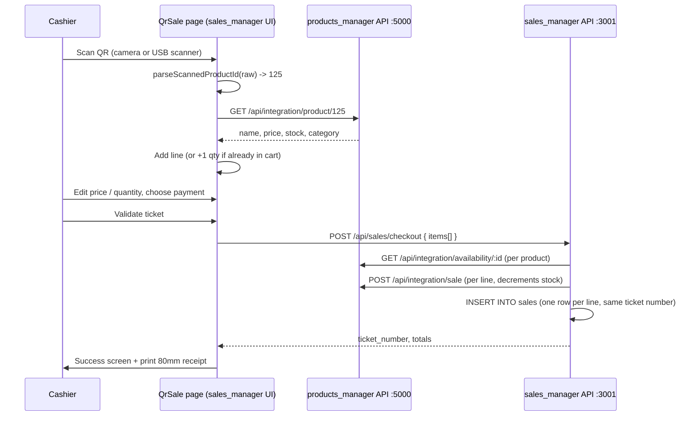

# SOHOFI BRICO — Roadmap

Focus: **QR-code point of sale** in `sales_manager`.
Scan a product QR code → read the product ID → fetch the product from the
`products_manager` catalogue → add a line to the sale table (price and quantity
editable) → validate the ticket → every line lands in *Historique Ventes* and the
stock is decremented in the catalogue.

Legend: `[x]` done · `[~]` partially done · `[ ]` to do

---

## Flow

---

## Phase 0 — Foundations (already in the repo)

- [x] `src/components/QrScanner.jsx` — camera scanner (html5-qrcode), camera picker, cooldown on repeated codes, green/red flash
- [x] `src/lib/qr.js` — `parseScannedProductId`, `generateProductQrDataUrl`, `playScanBeep`
- [x] `src/lib/print.js` — 80mm receipt HTML + QR label sheets / rolls, printed through a hidden iframe
- [x] `server/controllers/salesController.js` → `checkoutSale` (validation, stock pre-check, per-line processing, 207 partial result)
- [x] `server/routes/sales.js` → `POST /api/sales/checkout` (import fixed)
- [x] `Sale.create` accepts `sale_number`; `sales.sale_number` column exists in `bricojamal`
- [x] `/qr-sale` route registered in `App.jsx`

## Phase 1 — QR sale MVP (current sprint)

- [x] `src/components/QrSale.jsx` base page: scanner, manual / USB input, cart table, payment, checkout
- [ ] **Scanner compatibility**: accept the QR payload generated by `products_manager`
      (`"Id de Produit: 125\nNom de Produit: ...\nPrix de Vente: ...\nStock Actuel: ..."`)
- [ ] **i18n**: add every `qrSale.*` and `qrSale.scanner.*` key in `fr.json` and `ar.json` (page currently shows raw keys)
- [ ] **CSS**: `.qr-scan-line` animation and `.qr-reader video` sizing in `index.css`
- [ ] **Navigation**: "Vente QR" tab in `Navigation.jsx`
- [ ] **Sale table UX**
  - [ ] Quantity `-` / `+` steppers next to the input (blocked at available stock)
  - [ ] Editable unit price with "reset to catalogue price" when changed
  - [ ] Line subtotal, ticket totals (lines, units, amount in MAD)
  - [ ] Recent scans log (success / error, time)
- [ ] **Checkout result**
  - [ ] Clear error details for 409 (which product, available vs requested)
  - [ ] Success screen with ticket number, "Print receipt" (80mm) and "New sale"
- [ ] Cart persisted in `localStorage` (done) and restored after refresh

## Phase 2 — QR labels

- [ ] `src/components/QrLabels.jsx` ("Etiquettes QR")
  - [ ] Search catalogue products (`/api/integration/search`) and add them with N copies
  - [ ] Size (small / medium / large), layout (A4 sheet / label roll), show name, show price
  - [ ] Live preview + print via `buildLabelsHtml` + `generateProductQrDataUrl`
- [ ] `/qr-labels` route and "Etiquettes QR" nav tab
- [ ] Labels encode **only the product ID** (smallest, fastest QR to scan)

## Phase 3 — Hardening

- [ ] `products_manager` integration endpoints use `remaining_stock || stock_quantity`: a product with
      `remaining_stock = 0` reports its old `stock_quantity` instead of 0 → use `??`
- [ ] `products_manager/backend/server.js` registers `/api/integration/product/:identifier`,
      `/availability`, `/search` and `/low-stock` twice; only the first definition is used → remove duplicates
- [ ] Make checkout atomic: one `POST /api/integration/sale/batch` on the catalogue side in a single
      transaction, so a failure never leaves a half-saved ticket (removes the 207 case)
- [ ] Idempotency key on checkout (client-generated) so a network retry never double-sells
- [ ] `products_manager` should show an ID-only QR (same as labels) instead of the long text payload
- [ ] Hard-coded `http://localhost:3001` / `:5000` URLs in `SalesList`, `SalesForm`, `salesController.createSale`
      → use `config/integration.js` / `PRODUCTS_API_URL`
- [ ] Port 5000 conflict between `sales_manager/server.js` (mirror) and `products_manager/backend`

## Phase 4 — Point-of-sale features

- [ ] Attach a customer to a QR ticket (credit sales update customer balance)
- [ ] Ticket-level discount and per-line discount
- [ ] Group lines by ticket in *Historique Ventes* (dedicated `tickets` table instead of `[TKT-...]` in `notes`)
- [ ] Reprint any past ticket from the sales history
- [ ] EAN-13 / Code-128 barcode support (lookup by `barcode` / `sku`, not only ID)
- [ ] Keyboard-only mode for USB scanners (global key capture, F2 = checkout, Esc = clear)
- [ ] Daily cash closing report (Z report) from QR tickets

## Phase 5 — Platform

- [ ] Authentication and roles (cashier / manager) on both APIs
- [ ] Stop committing `.env` files, keep only `.env.example`
- [ ] Restrict CORS in production
- [ ] Offline queue for sales when the catalogue API is down
- [ ] Capacitor Android build of the QR sale page (phone as scanner)
- [ ] Automated tests for `parseScannedProductId`, `checkoutSale` and the cart logic

---

## Known constraints

- The camera requires **HTTPS or `localhost`**; on a LAN IP use the USB scanner / manual input or serve over HTTPS.
- A USB scanner acts as a keyboard: it types the code and presses Enter in the focused input.
- Prices are never trusted from the QR payload; every scan re-fetches the product from the catalogue.
