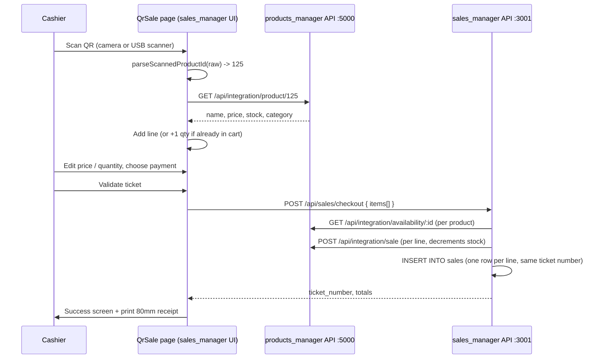

# SOHOFI BRICO — Roadmap

Focus: **QR-code point of sale** in `sales_manager`.
Scan a product QR code → read the product ID → fetch the product from the
`products_manager` catalogue → add a line to the sale table (price and quantity
editable) → validate the ticket → every line lands in *Historique Ventes* and the
stock is decremented in the catalogue.

Legend: `[~]` partially done · `[ ]` to do

> **Last verified against the code: 2026-11-13** — see [Verification log](#verification-log).
> **2026-11-10:** completed items removed (Phases 0–2 and the done items of Phase 3).
> **2026-11-13:** 6 more items found done in the code and removed. Only open work is listed.

## Progress

| Phase | Status | Remaining |
| --- | --- | --- |
| 3 — Hardening | **In progress (current sprint)** | 2 (both partial) |
| 4 — Point-of-sale features | Started | 6 (1 partial) |
| 5 — Platform | Not started | 5 |

---

## Flow

Current flow (per-line calls). The two `A->>P` calls (availability check + per-line sale) will be
replaced by a single `POST /api/integration/sale/batch` call once Phase 3 "atomic checkout" is wired.

---

## Phase 3 — Hardening (current sprint)

- [~] Make checkout atomic: one `POST /api/integration/sale/batch` on the catalogue side in a single
      transaction, so a failure never leaves a half-saved ticket (removes the 207 case)
  - [ ] Register the `products_manager/backend/integration/saleBatch.js` handler as a route in
        `products_manager/backend/server.js` and the `sales_manager/server.js` mirror
        (the module is not imported anywhere yet; `ensureIntegrationTables` is never called)
  - [ ] `checkoutSale` still loops over `/api/integration/availability` + `/api/integration/sale` → switch to the batch call
  - [ ] Remove the 207 partial path (`salesController.js:437`, `QrSale.jsx:566` + the `partial` banner around line 1003)
- [~] Idempotency key on checkout (client-generated) so a network retry never double-sells
  - [ ] `QrSale.jsx` does not generate / persist a key; `checkoutSale` does not accept or forward one
        (the server side is already in `saleBatch.js`)

## Phase 4 — Point-of-sale features (started)

- [ ] Ticket-level discount and per-line discount — `checkoutSale` hard-codes `discount: 0`
      (`saleBatch.js` already accepts a per-line `discount`)
- [ ] Group lines by ticket in *Historique Ventes* (dedicated `tickets` table instead of `[TKT-...]` in `notes`)
- [ ] Reprint any past ticket from the sales history
- [~] EAN-13 / Code-128 barcode support (lookup by `barcode` / `sku`, not only ID)
  - EAN-13 done: `QrScanner` and the phone page decode `QR_CODE` + `EAN_13`; `parseScannedCode` sends
    valid EAN-13 codes to `/api/integration/product/:code?by=barcode` (exact match)
  - [ ] Code-128 decoding (still only `QR_CODE` + `EAN_13`) and lookup by `sku`
- [ ] Keyboard-only mode for USB scanners (global key capture, F2 = checkout, Esc = clear)
- [ ] Daily cash closing report (Z report) from QR tickets

## Phase 5 — Platform (not started)

- [ ] Authentication and roles (cashier / manager) on both APIs
- [ ] Restrict CORS in production (`origin: '*'` in the sales API, open `cors()` in both products APIs)
- [ ] Offline queue for sales when the catalogue API is down
- [ ] Capacitor Android build of the QR sale page (phone as scanner) — only `products_manager` has a Capacitor config
- [ ] Automated tests for `parseScannedProductId`, `checkoutSale` and the cart logic (no test files exist yet)

---

## Verification log

**2026-11-13** — code reading only. Items found done and removed:

- `ViewProduct.tsx` QR encodes only `String(product.id)` (same as the labels)
- No hard-coded `localhost:3001` / `:5000` left in `sales_manager/src`: everything goes through
  `config/integration.js`. `salesController` uses `PRODUCTS_API_URL`
- Port conflict fixed: the mirror `sales_manager/server.js` reads `PRODUCTS_MIRROR_PORT` (not `PORT`) and
  exits quietly on `EADDRINUSE` when `products_manager/backend` already owns :5000
- `/api/health` is registered once in `products_manager/backend/server.js`
- Customer on QR tickets: `resolveCheckoutCustomer` links / creates the client, `customer_id` is saved on every
  line, credit sales require a client (UI + server), and the customer balance counts credit sales (`withAccountTotals`)
- `.env` files are untracked and ignored by the root `.gitignore` (`.env`, `.env.*`, `!.env.example`)

**2026-11-03** — statuses above checked against the code (MySQL not available, so no end-to-end sale was run):

- `node --check` passes on both products APIs, `saleBatch.js`, the sales API server, `salesController.js`, `routes/sales.js` and `models/Sale.js`
- `sales_manager` production build (`vite build`) succeeds
- i18n: 128 keys used by `QrSale`, `QrScanner` and `QrLabels` checked → 0 missing in `fr.json` / `ar.json`
- `parseScannedProductId` returns `125` for `125`, `#125`, `@125`, `ID:125`, `{"id":125}`, `https://...?id=125`
  and the full `products_manager` text payload; returns `null` for invalid input
- Integration route table of `products_manager/backend/server.js` reviewed: no duplicate `/api/integration/*` routes, no `/sale/batch` route

## Known constraints

- The camera requires **HTTPS or `localhost`**; on a LAN IP use the USB scanner / manual input or serve over HTTPS.
- A USB scanner acts as a keyboard: it types the code and presses Enter in the focused input.
- Prices are never trusted from the QR payload; every scan re-fetches the product from the catalogue.
