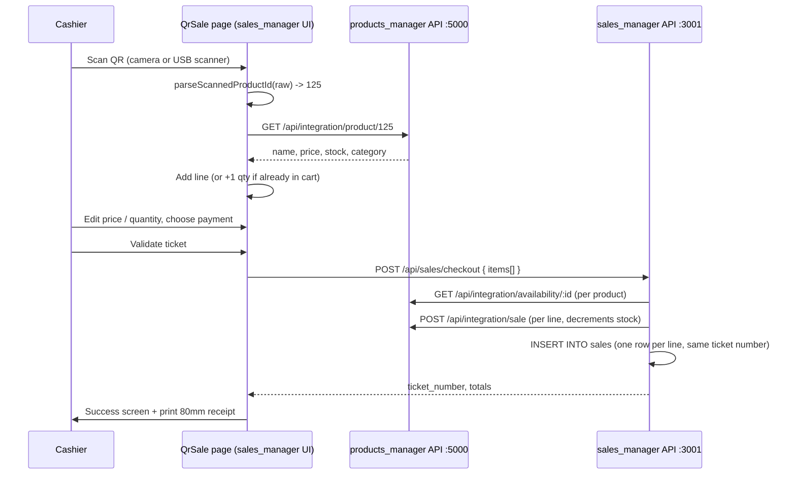

# SOHOFI BRICO — Roadmap

Focus: **QR-code point of sale** in `sales_manager`.
Scan a product QR code → read the product ID → fetch the product from the
`products_manager` catalogue → add a line to the sale table (price and quantity
editable) → validate the ticket → every line lands in *Historique Ventes* and the
stock is decremented in the catalogue.

Legend: `[x]` done · `[~]` partially done · `[ ]` to do

> **Last verified against the code: 2026-11-03** — see [Verification log](#verification-log).

## Progress

| Phase | Status | Done |
| --- | --- | --- |
| 0 — Foundations | Done | 7 / 7 |
| 1 — QR sale MVP | Done | 8 / 8 |
| 2 — QR labels | Done | 3 / 3 |
| 3 — Hardening | **In progress (current sprint)** | 2 / 8 · 2 partial |
| 4 — Point-of-sale features | Not started | 0 / 7 |
| 5 — Platform | Not started | 0 / 6 |

---

## Flow

Current flow (per-line calls). The two `A->>P` calls (availability check + per-line sale) will be
replaced by a single `POST /api/integration/sale/batch` call once Phase 3 "atomic checkout" is wired.

---

## Phase 0 — Foundations (done)

- [x] `src/components/QrScanner.jsx` — camera scanner (html5-qrcode), camera picker, cooldown on repeated codes (`SAME_CODE_COOLDOWN_MS = 1500`), green/red flash
- [x] `src/lib/qr.js` — `parseScannedProductId`, `generateProductQrDataUrl`, `playScanBeep` (+ `encodeProductQr`)
- [x] `src/lib/print.js` — 80mm receipt HTML (`buildReceiptHtml`) + QR label sheets / rolls (`buildLabelsHtml`), printed through a hidden iframe (`printHtml`)
- [x] `server/controllers/salesController.js` → `checkoutSale` (validation, stock pre-check, per-line processing, 207 partial result)
- [x] `server/routes/sales.js` → `POST /api/sales/checkout` (import fixed)
- [x] `Sale.create` accepts `sale_number`; `sales.sale_number` column exists in `bricojamal`
- [x] `/qr-sale` route registered in `App.jsx`

## Phase 1 — QR sale MVP (done)

- [x] `src/components/QrSale.jsx` base page: scanner, manual / USB input, cart table, payment, checkout
      (scans are queued so a fast USB scanner never loses a code)
- [x] **Scanner compatibility**: accepts the QR payload generated by `products_manager`
      (`"Id de Produit: 125\nNom de Produit: ...\nPrix de Vente: ...\nStock Actuel: ..."`),
      plus `125`, `#125`, `@125`, `ID:125`, `{"id":125}` and `https://...?id=125`
- [x] **i18n**: every `qrSale.*`, `qrSale.scanner.*`, `qrSale.receipt.*` and `nav.qrSale` key exists in `fr.json` and `ar.json`
- [x] **CSS**: `.qr-scan-line` keyframes, `.qr-reader video` / `canvas` sizing and `.qr-row-flash` in `index.css` (respects `prefers-reduced-motion`)
- [x] **Navigation**: "Vente QR" tab in `Navigation.jsx`
- [x] **Sale table UX**
  - [x] Quantity `-` / `+` steppers next to the input (blocked at available stock)
  - [x] Editable unit price with "reset to catalogue price" when changed
  - [x] Line subtotal, ticket totals (lines, units, amount in MAD)
  - [x] Recent scans log (success / error, time) — last 8 scans
- [x] **Checkout result**
  - [x] Clear error details for 409 (which product, available vs requested; affected lines turn red)
  - [x] Success screen with ticket number, "Print receipt" (80mm) and "New sale"
  - [x] Also handled: 503 (inventory offline), 400 (invalid lines), 207 (partial save), network drop (no auto-retry)
- [x] Cart and payment method persisted in `localStorage` and restored after refresh ("cart restored" notice)

## Phase 2 — QR labels (done)

- [x] `src/components/QrLabels.jsx` ("Etiquettes QR")
  - [x] Search catalogue products (`/api/integration/search?q=`) and add them with N copies
  - [x] Size (small / medium / large), layout (A4 sheet / label roll), show name, show price
  - [x] Live preview + print via `buildLabelsHtml` + `generateProductQrDataUrl`
- [x] `/qr-labels` route, "Etiquettes QR" nav tab and `qrLabels.*` keys in `fr.json` / `ar.json`
- [x] Labels encode **only the product ID** (`encodeProductQr` → smallest, fastest QR to scan)

## Phase 3 — Hardening (current sprint)

- [x] `products_manager` integration endpoints used `remaining_stock || stock_quantity` → now `??`
      in `products_manager/backend/server.js` and the `sales_manager/server.js` mirror (a product at 0 now reports 0)
- [x] `products_manager/backend/server.js` registered `/api/integration/product/:identifier`,
      `/availability`, `/search` and `/low-stock` twice → duplicates removed, each route is registered once
- [~] Make checkout atomic: one `POST /api/integration/sale/batch` on the catalogue side in a single
      transaction, so a failure never leaves a half-saved ticket (removes the 207 case)
  - [x] Handler written: `products_manager/backend/integration/saleBatch.js` (one transaction,
        `SELECT ... FOR UPDATE` in stable id order, all-or-nothing 409 on stock errors)
  - [ ] Register the route in `products_manager/backend/server.js` and the `sales_manager/server.js` mirror
        (the module is not imported anywhere yet; `ensureIntegrationTables` is never called)
  - [ ] `checkoutSale` still loops over `/api/integration/availability` + `/api/integration/sale` → switch to the batch call
  - [ ] Remove the 207 partial path (`salesController.js:316`, `QrSale.jsx:418`)
- [~] Idempotency key on checkout (client-generated) so a network retry never double-sells
  - [x] Server side ready in `saleBatch.js` (`integration_requests` table, stored response replayed, `ER_DUP_ENTRY` race handled)
  - [ ] `QrSale.jsx` does not generate / persist a key; `checkoutSale` does not accept or forward one
- [ ] `products_manager` should show an ID-only QR (same as labels) instead of the long text payload
      (`ViewProduct.tsx:1071` still encodes `Id de Produit / Nom / Prix / Stock`)
- [ ] Hard-coded `http://localhost:3001` / `:5000` URLs → use `config/integration.js` / `PRODUCTS_API_URL`.
      Still present in: `SalesList.jsx`, `SalesForm.jsx`, `Customers.jsx`, `CustomerDetails.jsx`,
      `CustomerWishlist.jsx`, `Suppliers.jsx`, `Reports.jsx`, `Inventory.jsx`, `OutOfStock.jsx`,
      `PriceHistory.jsx` and `salesController.createSale` (line 118)
- [ ] Port 5000 conflict between `sales_manager/server.js` (mirror, `PORT || 5000`) and `products_manager/backend`
- [ ] *(found during verification)* `/api/health` is still registered twice in `products_manager/backend/server.js`
      (lines 1276 and 1332, the first one wins) → keep one

## Phase 4 — Point-of-sale features (not started)

- [ ] Attach a customer to a QR ticket (credit sales update customer balance) — `checkoutSale` hard-codes `customer_id: null`
- [ ] Ticket-level discount and per-line discount — `checkoutSale` hard-codes `discount: 0`
      (`saleBatch.js` already accepts a per-line `discount`)
- [ ] Group lines by ticket in *Historique Ventes* (dedicated `tickets` table instead of `[TKT-...]` in `notes`)
- [ ] Reprint any past ticket from the sales history
- [ ] EAN-13 / Code-128 barcode support (lookup by `barcode` / `sku`, not only ID)
      — note: `/api/integration/product/:identifier` already matches `sku` / `barcode`, but `QrSale` only
      accepts numeric IDs and `QrScanner` only decodes `QR_CODE`
- [ ] Keyboard-only mode for USB scanners (global key capture, F2 = checkout, Esc = clear)
- [ ] Daily cash closing report (Z report) from QR tickets

## Phase 5 — Platform (not started)

- [ ] Authentication and roles (cashier / manager) on both APIs
- [ ] Stop committing `.env` files, keep only `.env.example`
      (`products_manager/backend/.env` and `sales_manager/server/.env` are tracked; no `.env` rule in any `.gitignore`)
- [ ] Restrict CORS in production (`origin: '*'` in the sales API, open `cors()` in both products APIs)
- [ ] Offline queue for sales when the catalogue API is down
- [ ] Capacitor Android build of the QR sale page (phone as scanner) — only `products_manager` has a Capacitor config
- [ ] Automated tests for `parseScannedProductId`, `checkoutSale` and the cart logic (no test files exist yet)

---

## Verification log

**2026-11-03** — statuses above checked against the code (MySQL not available, so no end-to-end sale was run):

- `node --check` passes on both products APIs, `saleBatch.js`, the sales API server, `salesController.js`, `routes/sales.js` and `models/Sale.js`
- `sales_manager` production build (`vite build`) succeeds
- i18n: 128 keys used by `QrSale`, `QrScanner` and `QrLabels` checked → 0 missing in `fr.json` / `ar.json`
- `parseScannedProductId` returns `125` for `125`, `#125`, `@125`, `ID:125`, `{"id":125}`, `https://...?id=125`
  and the full `products_manager` text payload; returns `null` for invalid input
- Integration route table of `products_manager/backend/server.js` reviewed: no duplicate `/api/integration/*` routes, no `/sale/batch` route

## Known constraints

- The camera requires **HTTPS or `localhost`**; on a LAN IP use the USB scanner / manual input or serve over HTTPS.
- A USB scanner acts as a keyboard: it types the code and presses Enter in the focused input.
- Prices are never trusted from the QR payload; every scan re-fetches the product from the catalogue.
