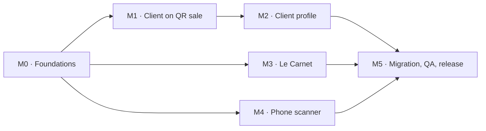
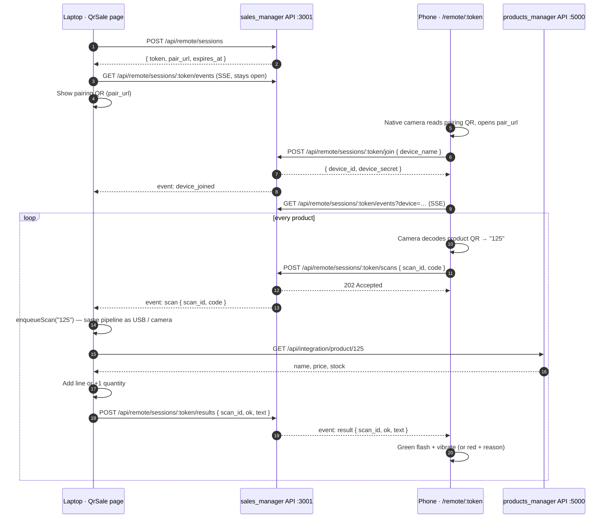

# SOHOFI BRICO — Roadmap v2

### Clients on the QR sale · Client profile · Le Carnet (الكناش) · Phone as a wireless scanner

| | |
| --- | --- |
| **Document** | Product & technical roadmap |
| **Version** | 2.0 — draft for review |
| **Date** | 2026-11-04 |
| **Owner** | Ibrahim Sohofi |
| **Applies to** | `sales_manager` (UI + API). Small changes in `products_manager` (M0 only) |
| **Status** | Proposed — waiting for the decisions in [§14](#14-decisions-needed-from-the-owner) |
| **Previous roadmap** | [`ROADMAP.md`](./ROADMAP.md) — Phases 0–5 (QR point of sale). This document continues it |

Legend: `[ ]` to do · `[~]` in progress · `[x]` done — Size: **S** small · **M** medium · **L** large · **XL** very large
(sizes are relative complexity, not calendar time).

---

## Table of contents

1. [Executive summary](#1-executive-summary)
2. [Goals and success metrics](#2-goals-and-success-metrics)
3. [Current state audit](#3-current-state-audit)
4. [Product principles](#4-product-principles)
5. [Delivery plan](#5-delivery-plan)
6. [M0 — Foundations](#6-m0--foundations)
7. [M1 — Epic A: Client on the QR sale](#7-m1--epic-a-client-on-the-qr-sale)
8. [M2 — Epic B: Client profile (Fiche client)](#8-m2--epic-b-client-profile-fiche-client)
9. [M3 — Epic C: Le Carnet (الكناش)](#9-m3--epic-c-le-carnet-الكناش)
10. [M4 — Epic D: Phone as a wireless scanner](#10-m4--epic-d-phone-as-a-wireless-scanner)
11. [M5 — Data migration, QA and release](#11-m5--data-migration-qa-and-release)
12. [Cross-cutting requirements](#12-cross-cutting-requirements)
13. [Risks and mitigations](#13-risks-and-mitigations)
14. [Decisions needed from the owner](#14-decisions-needed-from-the-owner)
15. [Definition of Done](#15-definition-of-done)
16. [Appendices](#16-appendices)

---

## Progress

| Milestone | Scope | Status | Done |
| --- | --- | --- | --- |
| M0 | Foundations (atomic checkout, migrations, tickets table) | In progress | 1 / 8 |
| M1 | Epic A — Client on the QR sale | In progress | 0 / 13 (story A-US6 done) |
| M2 | Epic B — Client profile | In progress | 2 / 15 |
| M3 | Epic C — Le Carnet | In progress | 2 / 18 |
| M4 | Epic D — Phone as a wireless scanner | Started, not checked | 0 / 17 |
| M5 | Data migration, QA and release | Not started | 0 / 9 |

> **2026-11-14:** completed items removed after checking the code: P-04, A-US6, B-02, B-03, C-01,
> C-04 and the findings they fixed (F-03, F-06, F-07, F-08). Only open and partial work is listed
> below. See [`ROADMAP_V2_STATUS.md`](./ROADMAP_V2_STATUS.md) for the partial items.

---

## 1. Executive summary

The QR point of sale works well for products, but it has no idea **who** is buying. Of the
**3,286 sales** in the current `bricojamal` database, **none** is linked to a client. Debts and
deals with people are tracked by hand in free-text notes (`"av 500dh+100+100…"`,
`"give: ampoule ingelec 9w / take: hilti 20dh"`).

This roadmap adds four capabilities, in the order you asked for:

| # | Initiative | What you get at the counter | Milestone |
| --- | --- | --- | --- |
| **A** | **Smart client field on the QR sale** | Type a name, a client number or a phone number. Matching clients show up as you type. On **Confirm sale**, a new client is added to the client list automatically. If the client has no name, a client number is generated and printed on the receipt | M1 |
| **B** | **Client profile (Fiche client)** | One page per client: edit their info, see every ticket, every product they bought, how much they spent, and what they still owe | M2 |
| **C** | **Le Carnet (الكناش)** | A personal ledger for the people you deal with (neighbours, artisans, friends, suppliers…): what you gave them, what they gave you, who owes whom, plus notes | M3 |
| **D** | **Phone as a wireless scanner** | Scan products with your phone next to the laptop. Each scan goes into the same QR-sale cart, and the phone vibrates green or red | M4 |

> **Is the phone idea possible?** Yes, and it works on your shop Wi-Fi without installing any app.
> The laptop shows a pairing QR code. The phone scans it with its normal camera and opens a
> full-screen scanner page. Every product the phone scans is sent to the laptop and handled by
> the same code as the camera and USB scanner. The main technical requirement is **HTTPS on the
> local network**, because phone browsers only allow the camera on secure pages. §10 explains
> how to set that up.

---

## 2. Goals and success metrics

| Goal | Metric | Target |
| --- | --- | --- |
| Attaching a client is fast | Time to select a known client on the QR sale | ≤ 3 keystrokes + Enter, < 3 s |
| No lost clients | Client creations that fail | 0 (today the 2nd client without an email fails, see F-03) |
| Purchase history is complete | QR tickets with a client that appear on the client profile | 100 % |
| Balances can be trusted | Displayed balance compared with the sum of movements | Always equal (recomputed, never typed by hand) |
| Phone scanning feels instant | Phone scan → line in the laptop cart, on shop Wi-Fi | < 1 s (p95) |
| No lost or doubled scans | 50 scans in a row from the phone | 50 increments, 0 lost, 0 duplicates |
| Bilingual quality | New strings present in `fr.json` **and** `ar.json`, RTL layout checked | 100 % |

**Non-goals for this roadmap:** multi-shop sync over the internet, accounting/VAT
declarations, card payment terminals, a native iPhone app.

---

## 3. Current state audit

Checked against the code on 2026-11-04. Each finding is linked to the milestone that fixes it.

| ID | Finding | Evidence | Impact | Fixed in |
| --- | --- | --- | --- | --- |
| F-01 | The QR sale has **no dedicated client field**. It only has *Payment* and *Notes*, so a name typed in Notes stays as free text | `QrSale.jsx` checkout body (lines 393–403) sends only `items`, `payment_method`, `notes` | Sales are never linked to a client | M1 |
| F-02 | The server ignores the client | `salesController.checkoutSale` sets `customer_id: null` (line 308) | 0 of 3,286 sales have a client | M1 |
| F-04 | Debts and deals are tracked by hand in text fields. `credit_limit` is used as "amount owed" | `notes = 'av 500dh+100+100+…'`, `notes = 'give: ampoule ingelec 9w\ntake : hilti 20dh'`, `credit_limit = 1178.00` | Totals can't be calculated and history gets lost | M2, M3, M5 |
| F-05 | Clients have no client number | No `code` column; the receipt prints no client | A client without a name can't be found again | M1 |
| F-09 | Updating a client overwrites every column | `Customer.update` writes all fields from the request body | A partial update erases data or throws | M2 |
| F-10 | Tickets exist only as a `[TKT-…]` prefix in `sales.notes` | `checkoutSale` → `ticketNote` | Lines can't be grouped by visit reliably | M0 (P-05) |
| F-11 | The phone camera needs HTTPS, and the API URLs are built as `protocol://host:3001` and `:5000` | `config/integration.js` → `getBaseUrl()` | On an HTTPS page, calls to the HTTP APIs are blocked as mixed content | M4 (D-01, D-02) |
| F-12 | There is no real-time channel | `WS_URL` is declared in `config/integration.js` but no WebSocket or SSE server exists | The phone can't push scans to the laptop | M4 |
| F-13 | Every route is wrapped in the app shell (header + navigation) | `App.jsx` | A full-screen phone page needs its own layout | M4 (D-06) |
| F-14 | Checkout is not atomic yet | `ROADMAP.md` Phase 3: batch endpoint not wired, idempotency key not sent | Adding client creation would multiply partial states | M0 (P-01, P-02) |

---

## 4. Product principles

1. **One cart pipeline.** Every scan (laptop camera, USB scanner, keyboard, phone) goes through
   `enqueueScan → processScan`. Same checks, same feedback, same stock rules.
2. **The server is the source of truth.** Prices, stock and balances are always recomputed on the
   server. Stored totals are only caches that get updated in the same transaction.
3. **Never lose a sale, never count it twice.** Atomic checkout plus an idempotency key, which
   also covers client creation.
4. **No friction at the counter.** Keyboard first. The default is a walk-in client. Nothing is
   required except a client for **credit** sales.
5. **Bilingual by design.** French first, full Arabic with RTL. Every new string goes into both
   locales in the same commit.
6. **Migrations never destroy data.** They are versioned and idempotent, a backup comes first, and
   legacy data is never deleted automatically.
7. **LAN first.** Everything runs on the shop network. Losing internet access must not stop sales.

---

## 5. Delivery plan

| Milestone | Scope | Depends on | Size | Exit criteria |
| --- | --- | --- | --- | --- |
| **M0** Foundations | Atomic checkout, idempotency, migration runner, `sale_tickets`, NULL emails | — | L | A ticket is saved fully or not at all. Migrations run at start-up |
| **M1** Client on the QR sale | Client field with suggestions while typing, auto-creation, client number, receipt | M0 | L | Acceptance criteria in §7.8 pass |
| **M2** Client profile | Profile page, edit, purchases, products, credit, merge | M1 | XL | Acceptance criteria in §8.9 pass |
| **M3** Le Carnet | People, entries, balances, statements, reminders | M0 | XL | Acceptance criteria in §9.10 pass |
| **M4** Phone scanner | HTTPS + same-origin proxy, pairing, real-time scans, phone page | M0 | XL | Acceptance criteria in §10.10 pass |
| **M5** Migration, QA, release | Legacy notes review, QA matrix, docs, release | M1–M4 | M | Release checklist in §11 complete |



**Recommended order:** M0 → M1 → M2 → M3 → M4 → M5 (the order you asked for). M3 and M4 depend
only on M0, so M4 can be done earlier if the phone scanner becomes the priority.

---

## 6. M0 — Foundations

**Why first:** M1 adds client creation to checkout, and M2–M4 add tables. Both need a checkout
that is atomic and retry-safe, plus a reliable way to change the schema.

| ID | Task | Files | Size | Status |
| --- | --- | --- | --- | --- |
| P-01 | Finish the atomic batch checkout from `ROADMAP.md` Phase 3: register `POST /api/integration/sale/batch`, switch `checkoutSale` to one batch call, remove the 207 partial path | `products_manager/backend/server.js`, `sales_manager/server.js`, `salesController.js`, `QrSale.jsx` | M | [ ] |
| P-02 | Idempotency key end to end. Generate it with `crypto.getRandomValues` (works on plain-HTTP LAN pages, unlike `crypto.randomUUID`), save it with the cart, clear it on success | `QrSale.jsx`, `salesController.js` | S | [ ] |
| P-03 | Versioned migration runner: `server/migrations/NNNN_name.sql` plus a `schema_migrations(version, applied_at)` table, applied in order by `runMigrations()`. Scripts `db:migrate`, `db:status` | `server/config/database.js`, `server/migrations/*`, `server/package.json` | M | [ ] |
| P-05 | Ticket header table `sale_tickets` plus `sales.ticket_id`. Backfill from the `[TKT-…]` prefix in `notes` | migration `0001`, `Sale.js`, `salesController.js` | M | [ ] |
| P-06 | Shared frontend API helper `src/lib/api.js` (timeout, JSON errors, `AbortController`), extracted from `QrSale.fetchJson`. Remove hard-coded `localhost` URLs (Phase 3 item) | `src/lib/api.js`, components listed in `ROADMAP.md` | M | [ ] |
| P-07 | Test harness: `bun test` for the server's pure functions (name normalization, balance math, payload parsing) | `server/tests/*`, `src/lib/*.test.js` | S | [ ] |
| P-08 | Seed script for a demo database (clients, tickets, Carnet entries) so every milestone can be checked without real data | `server/scripts/seed-demo.js` | S | [ ] |

```sql
-- migration 0001_tickets_and_nulls.sql
UPDATE customers SET email = NULL WHERE email = '';

CREATE TABLE sale_tickets (
  id               INT AUTO_INCREMENT PRIMARY KEY,
  ticket_number    VARCHAR(40)  NOT NULL,
  customer_id      INT          NULL,
  payment_method   ENUM('cash','credit','check','bank_transfer') NOT NULL DEFAULT 'cash',
  total_amount     DECIMAL(12,2) NOT NULL,
  total_units      INT          NOT NULL,
  discount         DECIMAL(12,2) NOT NULL DEFAULT 0,
  notes            VARCHAR(255) NULL,
  idempotency_key  VARCHAR(64)  NULL,
  source           ENUM('qr_sale','sales_form','import') NOT NULL DEFAULT 'qr_sale',
  created_at       TIMESTAMP    NOT NULL DEFAULT CURRENT_TIMESTAMP,
  UNIQUE KEY uq_ticket_number (ticket_number),
  UNIQUE KEY uq_ticket_idempotency (idempotency_key),
  KEY idx_tickets_customer_date (customer_id, created_at),
  CONSTRAINT fk_tickets_customer FOREIGN KEY (customer_id) REFERENCES customers(id) ON DELETE SET NULL
) ENGINE=InnoDB DEFAULT CHARSET=utf8mb4 COLLATE=utf8mb4_unicode_ci;

ALTER TABLE sales
  ADD COLUMN ticket_id INT NULL AFTER sale_number,
  ADD KEY idx_sales_ticket (ticket_id);
```

> Migrations are tracked by version, so they don't need `ADD COLUMN IF NOT EXISTS` (that syntax
> exists only in MariaDB). The same files run on MySQL 8 and on MariaDB.

**M0 exit criteria**
- [ ] Killing the sales API in the middle of a checkout leaves either the full ticket or nothing
- [ ] Sending the same checkout twice with the same key returns the same ticket and decrements stock once
- [ ] `bun run db:status` lists `0001` as applied, and a fresh database reaches the same schema

---

## 7. M1 — Epic A: Client on the QR sale

### 7.1 User stories

| ID | As a cashier, I want to… | So that… |
| --- | --- | --- |
| A-US1 | type the first letters of a client's name and pick them from the suggestions | the sale is linked to the right person in two seconds |
| A-US2 | type a **client number** (`C-0042`, `42`, `#42`) or a **phone number** and see the matching client | I can find clients whose name I don't remember |
| A-US3 | serve a client whose name I don't know, typing only a number or nothing at all | the system creates "Client C-0043" and prints that number on the receipt |
| A-US4 | type a new name and have the client added to the client list on **Confirm sale** | I never fill in a separate form at the counter |
| A-US5 | leave the field empty | a walk-in sale works exactly as it does today |
| A-US7 | scan the client QR printed on an old receipt | the client is selected instantly |

### 7.2 Behaviour of the client field

| What I type | What the suggestions show | What happens on **Confirm sale** |
| --- | --- | --- |
| *(nothing)* | — | Walk-in sale, `customer_id = NULL` |
| `ahm` | Matching clients, best first. Last rows: **+ Nouveau client « ahm »** and **+ Client sans nom** | Selected → linked · New → created, then linked |
| `C-0042` / `42` / `#42` | The client with that number first | Linked |
| `0612345678` | The client with that phone number. Otherwise **+ Nouveau client (tél. 0612…)** | Linked, or created with the phone number and the name "Client C-00xx" |
| `778` (no match) | **+ Client sans nom — réf. 778** | Created with `reference = 778` and the name "Client C-00xx" |
| **+ Client sans nom** | — | Created with the auto number only. "Client C-00xx" goes on the receipt |

**Ranking:** exact code → exact phone → exact reference → name starts with → a word starts
with → name contains. Ties are broken by most recent purchase.

**Normalization** (stored in `search_name`, computed in JS): lowercase, accents removed
(é → e), Arabic letters unified (أ إ آ → ا, ة → ه, ى → ي, harakat and tatweel removed),
and digits only for phone numbers. That way `ahmed`, `Ahmed` and `أحمد` / `احمد` all match.

**Keyboard:** `F4` focuses the client field · `↑`/`↓` move through suggestions · `Enter`
selects · `Esc` closes · `Backspace` on the selected client clears it.

**Selected client chip:** name, number, phone, a balance badge (amber "Doit 240,00 MAD" when credit
is outstanding), an `×` to clear, and an "Ouvrir la fiche" link.

**Duplicate guard:** choosing **+ Nouveau client « Ahmed »** while clients named Ahmed already
exist shows an inline hint ("2 clients nommés Ahmed existent — en choisir un ?"). It's a hint, not
a block. The merge tool in M2 fixes any mistakes.

**Persistence:** the selected client (or the pending new client) is saved with the cart in
`localStorage` (`salesManager.qrCustomer`). It's restored after a refresh and cleared on success
or when the cart is cleared.

### 7.3 Wireframe

```
┌ Client & paiement ────────────────────────────────────────────────┐
│ Client  (F4)                                                      │
│ ┌───────────────────────────────────────────────────────────────┐ │
│ │ ahm▌                                                          │ │
│ └───────────────────────────────────────────────────────────────┘ │
│  ▸ Ahmed Sécurité       C-0008 · 06 12 34 56 78     Doit 240,00   │
│    Ahmed Taxi           C-0004                           Soldé    │
│    + Nouveau client « ahm »                                       │
│    + Client sans nom (numéro automatique)                         │
│                                                                   │
│ Paiement  [ Espèces ▾ ]        Notes [ ........................ ] │
└───────────────────────────────────────────────────────────────────┘
```

### 7.4 Receipt and success screen

- The receipt gets **Client** and **N° client** rows, plus an optional QR `CLIENT:C-0043` with
  "Présentez ce ticket lors de votre prochain achat". The QR can be switched on or off.
- The success screen shows the client chip, a **"Nouveau client créé"** badge when one was
  created, and a link to the client's profile.
- Scanning a `CLIENT:` QR in the sale scanner selects the client and adds no product
  (`parseScannedPayload` returns `{ type: 'customer', code }`).

### 7.5 Data model

```sql
-- migration 0002_customer_identity.sql
ALTER TABLE customers
  ADD COLUMN code                 VARCHAR(20)  NULL AFTER id,
  ADD COLUMN reference            VARCHAR(50)  NULL AFTER code,
  ADD COLUMN search_name          VARCHAR(255) NULL,
  ADD COLUMN phone_digits         VARCHAR(20)  NULL,
  ADD COLUMN is_placeholder_name  TINYINT(1)   NOT NULL DEFAULT 0,
  ADD COLUMN source               ENUM('manual','qr_sale','import') NOT NULL DEFAULT 'manual',
  ADD COLUMN last_purchase_at     DATETIME     NULL,
  ADD UNIQUE KEY uq_customers_code (code),
  ADD KEY idx_customers_phone_digits (phone_digits),
  ADD KEY idx_customers_reference (reference),
  ADD KEY idx_customers_search_name (search_name);

UPDATE customers SET code = CONCAT('C-', LPAD(id, 4, '0')) WHERE code IS NULL;
-- search_name / phone_digits are backfilled by a JS step of the migration (same normalizer as the API)
```

- **Client number:** `C-` plus the id padded to 4 digits. It's set in the same transaction as the
  insert, so two cashiers can never get the same number.
- **No name:** `name` stays `NOT NULL`. A placeholder "Client C-0043" is stored with
  `is_placeholder_name = 1`, so the client list can filter **"Profils à compléter"**.

### 7.6 API contract

**`GET /api/customers/lookup?q=ahm&limit=8`** (registered before `/:id`)

```json
{
  "results": [
    { "id": 8, "code": "C-0008", "name": "Ahmed Sécurité", "phone": "0612345678",
      "balance": 240.00, "last_purchase_at": "2026-10-30T17:20:00Z", "match": "name_prefix" }
  ]
}
```

**`POST /api/sales/checkout`**: new fields

```jsonc
{
  "idempotency_key": "k_8f3c1a…",
  "customer": { "id": 8 },
  // or { "new": { "name": "Youssef", "phone": "0661…" } }
  // or { "new": { "anonymous": true, "reference": "778" } }
  // or null  → walk-in
  "items": [ … ], "payment_method": "cash", "notes": ""
}
```

The response adds `"customer": { "id": 43, "code": "C-0043", "name": "Client C-0043", "created": true }`.

**Server rules**

1. Validation: `payment_method = credit` without a client → `422 CREDIT_REQUIRES_CUSTOMER`.
   Unknown id → `404 CUSTOMER_NOT_FOUND`. Archived client → `409 CUSTOMER_ARCHIVED`.
2. The catalogue stock is decremented first with the **batch call and the same idempotency key**
   (one transaction in `products_manager`).
3. Then **one transaction in `bricojamal`**: find or create the client → insert the
   `sale_tickets` row → insert the lines (`sales.ticket_id`, `customer_id`) → update
   `last_purchase_at` (and the cached balance for credit sales) → commit.
4. The two databases can't share one transaction. If step 3 fails, the client retries with the
   **same key**: the catalogue replays its stored response (no second decrement) and step 3 runs
   again. A replayed key never creates a second client.

### 7.7 Work items

| ID | Task | Files | Size | Status |
| --- | --- | --- | --- | --- |
| A-01 | Migration `0002` (columns, unique code, backfill) | `server/migrations/0002_*.sql` | S | [ ] |
| A-02 | `normalizeName()` / `normalizePhone()` shared utilities with FR and AR tests | `server/utils/normalize.js` | S | [ ] |
| A-03 | `Customer.lookup(q, limit)` with the ranking from §7.2 | `server/models/Customer.js` | M | [ ] |
| A-04 | `GET /api/customers/lookup` route | `server/routes/customers.js`, `customerController.js` | S | [ ] |
| A-05 | `checkoutSale`: accept `customer`, find or create it in the transaction, credit rule, `last_purchase_at` | `salesController.js`, `Customer.js` | L | [ ] |
| A-06 | `useCustomerLookup` hook (150 ms debounce, `AbortController`, cache of the last 20 queries) | `src/hooks/useCustomerLookup.js` | S | [ ] |
| A-07 | `CustomerPicker` combobox (ARIA 1.2 combobox pattern, RTL, dark mode) | `src/components/customers/CustomerPicker.jsx` | L | [ ] |
| A-08 | QrSale integration: client card, `F4`, persistence, payload, credit check | `QrSale.jsx` | M | [ ] |
| A-09 | Success screen plus receipt rows and optional client QR | `QrSale.jsx`, `src/lib/print.js` | M | [ ] |
| A-10 | `parseScannedPayload()` with the `CLIENT:` prefix (products keep working as before) | `src/lib/qr.js` | S | [ ] |
| A-11 | Reuse `CustomerPicker` in the manual sale form | `SalesForm.jsx` | S | [ ] |
| A-12 | i18n `customerPicker.*` and the new `qrSale.*` keys in FR and AR | `fr.json`, `ar.json` | S | [ ] |
| A-13 | Tests: ranking, normalization, checkout with new / existing / anonymous / replayed key | `server/tests/*` | M | [ ] |

### 7.8 Acceptance criteria

- [ ] **Given** "Ahmed Sécurité" exists, **when** I type `ahm`, **then** he shows up in under 300 ms and `Enter` selects him.
- [ ] **Given** no client called "Youssef", **when** I type `Youssef` and confirm the sale, **then** exactly **one** client "Youssef" is created with a `C-00xx` number and `source = qr_sale`, and the ticket shows on his profile.
- [ ] **Given** I pick **+ Client sans nom**, **when** I confirm, **then** the receipt prints `Client : C-00xx` and the client list shows them under "Profils à compléter".
- [ ] **Given** the network drops after **Confirm** and I retry, **then** there is still one client, one ticket and one stock decrement.
- [ ] **Given** I scan a receipt QR `CLIENT:C-0043`, **then** that client is selected and no product is added.
- [ ] **Given** the UI is in Arabic, **then** the suggestions are right-aligned and `احمد` matches `أحمد`.
- [ ] **Given** the field is empty, **then** the sale behaves exactly as it does today (no regression).

---

## 8. M2 — Epic B: Client profile (Fiche client)

### 8.1 User stories

| ID | As the shop owner, I want to… |
| --- | --- |
| B-US1 | open a client and see at a glance how much they spent, how often they come, and what they owe |
| B-US2 | see **every ticket** they made, open it, and reprint it |
| B-US3 | see **every product** they bought, with quantities and totals |
| B-US4 | edit their info (name, number, phone, address, type, credit limit, notes) on the same page |
| B-US5 | record a payment and print or share a statement (relevé) |
| B-US6 | merge two profiles that are the same person |
| B-US7 | find "Profils à compléter" (clients created without a name) and complete them |
| B-US8 | start a new QR sale with this client already selected |

### 8.2 Page structure: `/customers/:id`

```
┌───────────────────────────────────────────────────────────────────────────┐
│ ← Clients    Ahmed Sécurité   [C-0008]  [Particulier]  créé via Vente QR  │
│ 06 12 34 56 78  (Appeler · WhatsApp)                                      │
│ [Nouvelle vente] [Modifier] [Paiement] [Relevé] [⋯ Fusionner / Archiver]  │
├───────────────────────────────────────────────────────────────────────────┤
│ Total dépensé │ Passages │ Articles │ Panier moyen │ Dernière visite │ Crédit │
│  4 350,00     │    17    │    52    │   255,88     │   il y a 3 j    │ 240,00 │
├───────────────────────────────────────────────────────────────────────────┤
│ [Aperçu] [Achats] [Produits] [Paiements & crédit] [Notes] [Modifier]      │
│                                                                           │
│  Aperçu: monthly spending chart (12 months) · top 5 products ·            │
│          last 5 tickets · Carnet card (if linked)                         │
└───────────────────────────────────────────────────────────────────────────┘
```

| Tab | Content |
| --- | --- |
| **Aperçu** | KPI cards, monthly spending chart (`recharts`, already a dependency), top 5 products, last 5 tickets, Carnet balance if linked |
| **Achats** | Ticket table: date · ticket number · lines · units · payment · total. Rows expand to show lines. Filters: 30 days / 3 months / year / all, payment method. Actions: reprint receipt, open in *Historique*. Older lines without a ticket are grouped by day as "Ventes sans ticket" |
| **Produits** | One row per product: category · times bought · total quantity · total spent · average price paid · last bought. Sortable, searchable, CSV export |
| **Paiements & crédit** | Statement: credit sales (+), payments (−), running balance, opening balance. "Add payment" form. Credit limit gauge |
| **Notes** | Free notes (the existing `notes` field) plus an event timeline (created from the QR sale, edited, merged) |
| **Modifier** | Edit form (§8.4) |

### 8.3 KPI definitions

| KPI | Formula |
| --- | --- |
| Total dépensé | Σ `sale_tickets.total_amount` + Σ older `sales.totalPrice` without a ticket (same `customer_id`) |
| Passages | Count of tickets + count of distinct days for older lines without a ticket |
| Articles | Σ `sales.quantity` |
| Panier moyen | Total dépensé ÷ Passages |
| Dernière visite | `customers.last_purchase_at` (recomputed if missing) |
| Crédit en cours | `opening_balance` + Σ credit tickets − Σ `customer_payments.amount` |

Balances are **computed from movements**. `customers.balance` stays as a cache, updated in the
same transaction, and `POST /api/customers/:id/recompute` repairs it.

### 8.4 Edit rules

- **PATCH semantics:** only the fields that changed are written (fixes F-09).
- Validation: the name is required, unless the profile stays a placeholder. Phone: Moroccan
  formats `05/06/07…` or `+212…`, normalized into `phone_digits`. Email is optional and unique
  when set. The client number is unique and editable (with a warning that old receipts show the
  old number).
- Conflicts return `409` with the field name, shown inline under that field.
- An unsaved-changes guard runs when leaving the tab. A toast confirms the save.
- Completing a placeholder name automatically sets `is_placeholder_name = 0`.

### 8.5 Merge duplicates

`POST /api/customers/:targetId/merge { "source_id": 51 }` runs in one transaction:

1. Moves `sales`, `sale_tickets`, `customer_payments`, `customer_products`, `customer_wishlist`
   and `ledger_contacts` from the source to the target.
2. Appends the source's notes to the target's notes, with a date header.
3. Marks the source `is_active = 0` with `merged_into_id = target`.
4. Recomputes the target's balance.

The UI shows a side-by-side preview with counts before you confirm.

### 8.6 Client list upgrades (`/customers`)

- Columns: number · name · phone · total spent · credit · last visit.
- Search by name, number, phone or reference (same `lookup` engine as M1).
- Filters: **Profils à compléter** · **Avec crédit** · **Inactifs 90 j** · **Créés via Vente QR** · Archivés.
- Sorting by last visit, total spent or credit. Server-side pagination.
- The row click opens the profile. The edit modal is kept for quick edits.

### 8.7 API

| Method | Endpoint | Purpose |
| --- | --- | --- |
| GET | `/api/customers/:id/summary` | KPIs from §8.3 |
| GET | `/api/customers/:id/tickets?from&to&payment&page&page_size` | Paginated tickets |
| GET | `/api/customers/:id/tickets/:ticketId` | Ticket lines (also used to reprint) |
| GET | `/api/customers/:id/products?from&to&sort` | Purchases grouped by product |
| GET | `/api/customers/:id/spending?months=12` | Monthly series for the chart |
| GET | `/api/customers/:id/statement?from&to` | Credit statement with running balance |
| PATCH | `/api/customers/:id` | Partial update |
| POST | `/api/customers/:id/merge` | Merge a duplicate into this client |
| POST | `/api/customers/:id/restore` | Un-archive |
| POST | `/api/customers/:id/recompute` | Rebuild cached totals |
| GET | `/api/customers?sort=&filter=&page=` | Upgraded list |

```sql
-- migration 0003_customer_profile.sql
ALTER TABLE customers
  ADD COLUMN opening_balance      DECIMAL(12,2) NOT NULL DEFAULT 0,
  ADD COLUMN opening_balance_note VARCHAR(255)  NULL,
  ADD COLUMN merged_into_id       INT           NULL,
  ADD KEY idx_customers_last_purchase (last_purchase_at);
```

### 8.8 Work items

| ID | Task | Files | Size | Status |
| --- | --- | --- | --- | --- |
| B-01 | Migration `0003` | `server/migrations/0003_*.sql` | S | [ ] |
| B-04 | `Customer.patch()` plus a `PATCH` route; keep `PUT` for compatibility (F-09) | `Customer.js`, `customerController.js`, `routes/customers.js` | M | [ ] |
| B-05 | Summary, tickets, products, spending and statement queries plus routes | `Customer.js`, `customerController.js` | L | [ ] |
| B-06 | Merge, restore and recompute endpoints (transactions) | `Customer.js`, `customerController.js` | M | [ ] |
| B-07 | Rebuild `CustomerDetails.jsx` as a tabbed profile page with a header and KPI cards | `src/components/customers/CustomerProfile/*` | L | [ ] |
| B-08 | **Achats** tab with expandable tickets and receipt reprint (reuses `buildReceiptHtml`) | `…/PurchasesTab.jsx`, `src/lib/print.js` | M | [ ] |
| B-09 | **Produits** tab with sorting and CSV export | `…/ProductsTab.jsx` | M | [ ] |
| B-10 | **Paiements & crédit** tab: statement, add payment, print or WhatsApp statement | `…/CreditTab.jsx` | M | [ ] |
| B-11 | **Modifier** tab with PATCH, inline errors and the unsaved-changes guard | `…/EditTab.jsx` | M | [ ] |
| B-12 | Merge dialog with a side-by-side preview | `…/MergeDialog.jsx` | M | [ ] |
| B-13 | Client list upgrades (columns, filters, sorting, pagination) | `Customers.jsx` | M | [ ] |
| B-14 | "Nouvelle vente" deep link: `/qr-sale?customer=8` preselects the client | `QrSale.jsx` | S | [ ] |
| B-15 | i18n `customerProfile.*` in FR and AR, plus tests for the KPI formulas | `fr.json`, `ar.json`, `server/tests/*` | M | [ ] |

### 8.9 Acceptance criteria

- [ ] After 3 QR sales for a client (one on credit), the profile shows 3 tickets, the right totals and the credit amount.
- [ ] Every product from those tickets appears on **Produits** with the right quantities and totals.
- [ ] Editing only the phone number leaves all other fields unchanged.
- [ ] Merging B into A moves every ticket, payment and wishlist item. B disappears from the list and A's totals equal the sum of both.
- [ ] Recording a payment of 100 lowers the credit by 100 straight away, and the statement shows the new running balance.
- [ ] Reprinting a past ticket produces the same receipt as the original.
- [ ] **Profils à compléter** lists clients without a name. Giving one a name removes it from that filter.

---

## 9. M3 — Epic C: Le Carnet (الكناش)

### 9.1 Concept

Moroccan shopkeepers have always kept a **kunnash** (الكناش): a notebook of who owes what. This
module is that notebook, digital and searchable. It covers **people** (neighbours, artisans, other
shop owners, family, friends, suppliers you deal with informally) and every **movement** between
you: money, goods, services, plus plain notes.

It's **separate from the shop's sales and credit**, because personal deals shouldn't distort
sales figures. A person can still be **linked** to a client or supplier, and both balances then
show on that profile.

### 9.2 Vocabulary (simple, two directions only)

| Action | FR (UI) | AR (UI) | Effect on the balance |
| --- | --- | --- | --- |
| I gave money, goods or a service | **J'ai donné** | **أعطيت** | **+** → they owe me more |
| I received money, goods or a service | **J'ai reçu** | **أخذت** | **−** → I owe them more |
| Repayment | Same buttons, with a *Remboursement* tag | — | Moves the balance back towards zero |
| Note | **Note** | **ملاحظة** | No effect |

**Balance = Σ given − Σ received** (valued entries only).

- `> 0` → green **"Il me doit 350,00 MAD"** / **"عليه 350,00 درهم"**
- `< 0` → red **"Je lui dois 120,00 MAD"** / **"عليّ 120,00 درهم"**
- `= 0` → grey **"Soldé"** / **"مسوّى"**

**Goods without a known value** (for example "ampoule ingelec 9w") are allowed. They show in the
history with a "non valorisé" badge and don't change the balance until you add a value.

### 9.3 Scope

| MVP (M3) | Later |
| --- | --- |
| People: add, edit, archive, pin, relation, phone, notes | Photo attachments (receipt or paper note) |
| Entries: given / received × money / goods / service / note | Edit history (revisions) for each entry |
| Live balance per person, totals ("On me doit", "Je dois", net) | Pick goods from the catalogue (read only, no stock change) |
| Due dates plus an **"À relancer"** list and a dashboard widget | Recurring entries (monthly rent, salary advance) |
| Settle in one tap (creates the balancing entry) | Excel export |
| Statement: print on 80 mm or A4, share as WhatsApp text | PIN lock (after real auth from Phase 5) |
| **Discreet mode**: amounts blurred until you tap, for when customers can see the screen | Multi-currency |
| Search, filters, sorting · soft delete with **Undo** | |
| Optional link to a client or supplier, shown on their profile | |

### 9.4 Screens

**Carnet home: `/carnet`**

```
┌ Le Carnet ──────────────────────────────────────── [Mode discret ◐] [+ Personne] ┐
│  On me doit          Je dois             Net               À relancer            │
│  2 480,00 MAD        620,00 MAD          +1 860,00 MAD     3 personnes           │
├──────────────────────────────────────────────────────────────────────────────────┤
│ [Rechercher…]   (Tous)(Me doivent)(Je dois)(Soldés)(En retard)(Archivés)  Tri ▾   │
├──────────────────────────────────────────────────────────────────────────────────┤
│ (RA) Rachid · Voisin         "Reçu: hilti 20dh" · il y a 2 j     Il me doit 180  [+]│
│ (OJ) Othmane · Artisan       "Donné: pile GM Duracell" · 5 j     Je lui dois 45  [+]│
│ (MT) Moul taxi · Client      "Remboursement 50" · 1 mois           Soldé         [+]│
└──────────────────────────────────────────────────────────────────────────────────┘
```

**Person page: `/carnet/:id`.** A chat-style timeline: what **I gave** sits on one side, what
**I received** sits on the other, grouped by day, with the running balance under each bubble.
This is the screen people will remember.

```
┌ ← Carnet   Rachid  · Voisin · 06 61 …  (Appeler · WhatsApp)     Il me doit 180,00 ┐
│ [J'ai donné] [J'ai reçu] [Note] [Solder] [Relevé]                                  │
├────────────────────────────────────────────────────────────────────────────────────┤
│                      — 17 janv. 2026 —                                            │
│  ┌ Donné · Marchandise ───────┐                                                    │
│  │ Ampoule Ingelec 9W  × 2    │                                                    │
│  │ non valorisé               │                                                    │
│  └────────────────────────────┘                                                    │
│                                         ┌ Reçu · Argent ───────────────┐           │
│                                         │ Hilti — 20,00 MAD            │           │
│                                         └─────────── solde : −20,00 ───┘           │
│                      — 02 nov. 2026 —                                             │
│  ┌ Donné · Argent ────────────┐                                                    │
│  │ Prêt — 200,00 MAD          │                                                    │
│  │ à rendre le 15/11          │                                                    │
│  └──── solde : +180,00 ───────┘                                                    │
├────────────────────────────────────────────────────────────────────────────────────┤
│ Notes sur Rachid: "Habite au 2e étage, paie toujours en fin de mois."   [Modifier] │
└────────────────────────────────────────────────────────────────────────────────────┘
```

**Quick entry sheet** (opens from `[+]` on any row, or from the person page)

- A large **J'ai donné / J'ai reçu** toggle, coloured by direction
- Type: **Argent · Marchandise · Service · Note**
- Amount with quick chips (+10 · +50 · +100 · +500). For goods: item name, quantity and an optional value
- Date (today by default) · optional due date (1 week · 1 month · custom) · description
- A *Remboursement* tag, suggested automatically when the direction reduces the current balance
- `Enter` saves and `Esc` closes. Undo for 5 seconds after saving.

### 9.5 Data model

```sql
-- migration 0004_ledger.sql
CREATE TABLE ledger_contacts (
  id           INT AUTO_INCREMENT PRIMARY KEY,
  name         VARCHAR(255) NOT NULL,
  nickname     VARCHAR(100) NULL,
  phone        VARCHAR(50)  NULL,
  relation     ENUM('friend','family','neighbor','artisan','supplier','employee','customer','other')
               NOT NULL DEFAULT 'other',
  customer_id  INT NULL,
  supplier_id  INT NULL,
  notes        TEXT NULL,
  color        VARCHAR(16) NULL,
  is_pinned    TINYINT(1) NOT NULL DEFAULT 0,
  is_archived  TINYINT(1) NOT NULL DEFAULT 0,
  search_name  VARCHAR(255) NULL,
  created_at   TIMESTAMP NOT NULL DEFAULT CURRENT_TIMESTAMP,
  updated_at   TIMESTAMP NOT NULL DEFAULT CURRENT_TIMESTAMP ON UPDATE CURRENT_TIMESTAMP,
  KEY idx_ledger_contacts_search (search_name),
  KEY idx_ledger_contacts_customer (customer_id),
  CONSTRAINT fk_ledger_contacts_customer FOREIGN KEY (customer_id) REFERENCES customers(id) ON DELETE SET NULL,
  CONSTRAINT fk_ledger_contacts_supplier FOREIGN KEY (supplier_id) REFERENCES suppliers(id) ON DELETE SET NULL
) ENGINE=InnoDB DEFAULT CHARSET=utf8mb4 COLLATE=utf8mb4_unicode_ci;

CREATE TABLE ledger_entries (
  id             INT AUTO_INCREMENT PRIMARY KEY,
  contact_id     INT NOT NULL,
  entry_date     DATE NOT NULL,
  direction      ENUM('out','in') NOT NULL,              -- out = J'ai donné, in = J'ai reçu
  kind           ENUM('money','goods','service','note') NOT NULL DEFAULT 'money',
  amount         DECIMAL(12,2) NULL,                     -- NULL = not valued (goods / note)
  item_name      VARCHAR(255) NULL,
  item_quantity  DECIMAL(10,2) NULL,
  description    TEXT NULL,
  due_date       DATE NULL,
  is_repayment   TINYINT(1) NOT NULL DEFAULT 0,
  is_settlement  TINYINT(1) NOT NULL DEFAULT 0,
  deleted_at     TIMESTAMP NULL,
  created_at     TIMESTAMP NOT NULL DEFAULT CURRENT_TIMESTAMP,
  updated_at     TIMESTAMP NOT NULL DEFAULT CURRENT_TIMESTAMP ON UPDATE CURRENT_TIMESTAMP,
  KEY idx_ledger_entries_contact_date (contact_id, entry_date),
  KEY idx_ledger_entries_due (due_date),
  CONSTRAINT fk_ledger_entries_contact FOREIGN KEY (contact_id) REFERENCES ledger_contacts(id) ON DELETE CASCADE,
  CONSTRAINT chk_ledger_amount CHECK (amount IS NULL OR amount > 0)
) ENGINE=InnoDB DEFAULT CHARSET=utf8mb4 COLLATE=utf8mb4_unicode_ci;
```

```sql
-- balance per person (never stored, always computed)
SELECT contact_id,
       SUM(CASE WHEN direction = 'out' THEN amount ELSE -amount END) AS balance
FROM ledger_entries
WHERE deleted_at IS NULL AND amount IS NOT NULL
GROUP BY contact_id;
```

### 9.6 API

| Method | Endpoint | Purpose |
| --- | --- | --- |
| GET | `/api/ledger/summary` | Totals: owed to me, I owe, net, overdue count |
| GET | `/api/ledger/contacts?q&status=owes_me\|i_owe\|settled\|overdue\|archived&sort` | List with balances and last entry |
| POST | `/api/ledger/contacts` | Create a person |
| GET | `/api/ledger/contacts/:id` | Person, balance and notes |
| PATCH | `/api/ledger/contacts/:id` | Edit, pin, archive |
| GET | `/api/ledger/contacts/:id/entries?from&to` | Timeline with running balance |
| POST | `/api/ledger/contacts/:id/entries` | Add an entry |
| PATCH | `/api/ledger/entries/:id` | Edit an entry |
| DELETE | `/api/ledger/entries/:id` | Soft delete (`deleted_at`) |
| POST | `/api/ledger/entries/:id/restore` | Undo a delete |
| POST | `/api/ledger/contacts/:id/settle` | Create the balancing entry |
| GET | `/api/ledger/contacts/:id/statement?from&to&format=json\|text` | Statement (the text format is used for WhatsApp) |

### 9.7 Business rules

1. Amounts are always positive; the direction gives the sign.
2. A **Note** entry never has an amount.
3. **Settle** creates one entry in the opposite direction for exactly the current balance, tagged `is_settlement`.
4. **Overdue** means a due date in the past while the balance is still in my favour for that person.
5. Deletes are soft: Undo for 5 seconds in the UI, and they stay recoverable from the API.
6. WhatsApp sharing uses `https://wa.me/212XXXXXXXXX?text=…`. The number is normalized from `06…` to `2126…`, and the text follows the UI language.
7. **Discreet mode** is remembered per device (`localStorage`). It blurs amounts in the list, the summary and the timeline.

### 9.8 Privacy note

The Carnet holds personal financial information, and the APIs have **no authentication yet**
(`ROADMAP.md` Phase 5). Until auth exists: the app is used on the LAN only, discreet mode is on by
default, and the Carnet routes get a clear "local network only" warning in the README.
**Recommendation:** move "Authentication and roles" up so it lands right after M3.

### 9.9 Work items

| ID | Task | Files | Size | Status |
| --- | --- | --- | --- | --- |
| C-02 | `LedgerContact` and `LedgerEntry` models (balances, running balance, overdue) | `server/models/Ledger*.js` | M | [ ] |
| C-03 | Controllers and routes from §9.6, with validation | `server/controllers/ledgerController.js`, `server/routes/ledger.js`, `server/server.js` | M | [ ] |
| C-05 | Navigation tab **Carnet / الكناش** plus the `/carnet` and `/carnet/:id` routes | `Navigation.jsx`, `App.jsx` | S | [ ] |
| C-06 | Carnet home: summary cards, filters, search, sorting, list | `src/components/ledger/LedgerHome.jsx` | L | [ ] |
| C-07 | Person page header: balance, call and WhatsApp, actions | `src/components/ledger/LedgerContactPage.jsx` | M | [ ] |
| C-08 | Chat-style timeline with running balance and day separators (RTL mirrored) | `src/components/ledger/LedgerTimeline.jsx` | L | [ ] |
| C-09 | Quick entry sheet (direction, type, chips, due date, repayment suggestion) | `src/components/ledger/LedgerEntrySheet.jsx` | L | [ ] |
| C-10 | Person form (create, edit, link to a client or supplier) | `src/components/ledger/LedgerContactForm.jsx` | M | [ ] |
| C-11 | Settle confirmation, undo toasts, soft delete | `ledger/*` | S | [ ] |
| C-12 | Statement: print on 80 mm and A4, share on WhatsApp | `src/lib/print.js`, `ledger/*` | M | [ ] |
| C-13 | Discreet mode (blur plus tap to reveal, remembered) | `src/hooks/useDiscreetMode.js` | S | [ ] |
| C-14 | Dashboard widget "À relancer" plus a nav badge with the overdue count | `Dashboard.jsx`, `Navigation.jsx` | S | [ ] |
| C-15 | Carnet card on the client profile when linked | `CustomerProfile/*` | S | [ ] |
| C-16 | i18n `ledger.*` in FR and AR (with the Darija-friendly wording from §9.2) | `fr.json`, `ar.json` | M | [ ] |
| C-17 | Tests: balance math, settle, overdue, soft delete and restore | `server/tests/*` | M | [ ] |
| C-18 | Empty states and onboarding ("Ajoutez votre première personne") | `ledger/*` | S | [ ] |

### 9.10 Acceptance criteria

- [ ] I add "Rachid", then **J'ai donné** 200 → the list shows **Il me doit 200,00**.
- [ ] Then **J'ai reçu** 20 → **Il me doit 180,00**, and the timeline shows both bubbles with their running balances.
- [ ] Goods without a value appear in the timeline and leave the balance unchanged.
- [ ] **Solder** brings the balance to 0, and the person moves to the *Soldés* filter.
- [ ] An entry with a past due date and an open balance shows in **À relancer** and on the dashboard.
- [ ] Deleting an entry, then **Undo**, restores it and the balance.
- [ ] The WhatsApp statement opens with the right number and an FR or AR text matching the UI language.
- [ ] Discreet mode hides every amount on the Carnet pages until I tap.
- [ ] In Arabic, the timeline is mirrored and every label is translated.

---

## 10. M4 — Epic D: Phone as a wireless scanner

### 10.1 Feasibility verdict

**Feasible with the current stack**, and the core needs no extra npm dependency:

- **Phone camera:** `html5-qrcode`, already used by `QrScanner.jsx`, works in mobile Chrome and Safari **over HTTPS**.
- **Phone → server:** a plain `POST` per scan.
- **Server → laptop and phone:** **Server-Sent Events** (SSE) over Express. They're one-way, reconnect automatically, and need no library.
- **Pairing:** the `qrcode` package (already installed) draws the pairing QR on the laptop.

### 10.2 User flow

1. On the laptop's QR sale page, click **"Connecter un téléphone"**.
2. A dialog shows a pairing QR (the URL contains a one-time session token) and the laptop's LAN address.
3. Point the phone's normal camera at it. It opens **`https://<laptop-ip>:5174/remote/<token>`**, a full-screen scanner page with no app to install.
4. The laptop shows **"Téléphone connecté (Samsung A54)"**.
5. Scan products with the phone. Each scan appears in the laptop cart in under a second, and the phone flashes green with a short vibration, or red with the reason (out of stock, unknown code…).
6. Confirm the sale on the laptop as usual. The pairing stays active for the next customer.

### 10.3 Architecture



### 10.4 HTTPS and networking

Phone browsers only open the camera on **secure** pages (HTTPS, or `localhost` on the device
itself). Over HTTPS, every API call must also be HTTPS on the **same origin**, otherwise the
browser blocks it as mixed content (see F-11).

**Target setup:** Vite serves the UI over HTTPS and proxies the APIs, so the phone only talks to
one origin.

```js
// sales_manager/vite.config.js (sketch)
server: {
  host: "0.0.0.0",
  https: { key: CERT_KEY, cert: CERT_FILE },     // mkcert files, or @vitejs/plugin-basic-ssl
  proxy: {
    "/api":         { target: "http://localhost:3001", changeOrigin: true },   // SSE passes through
    "/catalog-api": { target: "http://localhost:5000", changeOrigin: true,
                      rewrite: (p) => p.replace(/^\/catalog-api/, "/api") },
  },
}
```

With `VITE_SAME_ORIGIN=true`, `config/integration.js` uses relative bases (`""` and
`"/catalog-api"`) instead of `protocol://host:port`. Without it, today's behaviour is unchanged.

| Option | How | Pros | Cons | Verdict |
| --- | --- | --- | --- | --- |
| **A. Self-signed HTTPS** (`@vitejs/plugin-basic-ssl`) + same-origin proxy | One plugin plus the proxy above | Nothing to install on the phone. Android and iPhone | A one-time "connection not private" warning on each phone | **MVP** |
| **B. mkcert local certificate** | Create a local CA and install it once on each phone | No warnings, feels professional | Setup per phone (iPhone needs a profile and "trust") | **Recommended for daily use** |
| **C. Capacitor Android app** (`@capacitor/*` is already in `sales_manager/package.json`) | Native camera with a barcode plugin | Fastest decoding, EAN-13/Code-128, no certificate | Android only. An APK to build and sign | Later (D-16) |
| **D. Off-the-shelf "phone → PC scanner" app** (keyboard emulation) | The app types the code into the focused input | No code, usable today with the existing manual input | Third-party app. The input must keep focus. No stock feedback on the phone | **Interim only** |

**Network checklist:** the laptop and phone are on the same Wi-Fi. The firewall allows inbound
port 5174 on the **private** network profile. The laptop's LAN IP comes from
`GET /api/remote/network` (`os.networkInterfaces()`, private IPv4 only). If there are several, the
dialog lets you choose.

**Production on the shop PC:** serve the built `dist/` from one HTTPS server (Vite `preview` with
the same proxy, or Express with the mkcert certificate). One origin and one port to open.

### 10.5 Session protocol

| Method | Endpoint | Caller | Purpose |
| --- | --- | --- | --- |
| POST | `/api/remote/sessions` | Laptop | Create a session → `{ token, pair_url, expires_at }` |
| GET | `/api/remote/sessions/:token/events` | Laptop | SSE: `device_joined`, `device_left`, `scan` |
| DELETE | `/api/remote/sessions/:token` | Laptop | End the session and disconnect all phones |
| DELETE | `/api/remote/sessions/:token/devices/:deviceId` | Laptop | Disconnect one phone |
| POST | `/api/remote/sessions/:token/join` | Phone | `{ device_name }` → `{ device_id, device_secret }` |
| GET | `/api/remote/sessions/:token/events?device=…` | Phone | SSE: `result`, `cart_locked`, `cart_unlocked`, `session_ended` |
| POST | `/api/remote/sessions/:token/scans` | Phone | `{ scan_id, code }` → `202`, or `423` when the cart is locked |
| POST | `/api/remote/sessions/:token/results` | Laptop | `{ scan_id, ok, text, product_name?, quantity? }` |
| GET | `/api/remote/network` | Laptop | LAN IPv4 addresses for the pairing URL |

**Server implementation:** `services/remoteSessions.js` keeps sessions in memory (`Map`), which is
fine for a single shop server process. SSE needs `Content-Type: text/event-stream`,
`Cache-Control: no-cache` and `X-Accel-Buffering: no`, a `:heartbeat` comment every 15 s, and
`retry: 2000`. Expired sessions are cleaned up every minute.

### 10.6 Phone page UX: `/remote/:token` (full-screen, outside the app shell)

```
┌──────────────────────────────┐
│ ● Connecté à la caisse   ✕   │
│ ┌──────────────────────────┐ │
│ │                          │ │
│ │      camera viewfinder   │ │
│ │      ─ ─ scan line ─ ─   │ │
│ │                          │ │
│ └──────────────────────────┘ │
│  [Lampe] [Caméra] [Saisie] [Pause] │
├──────────────────────────────┤
│ ✓ Rallonge 3 prises   ×2     │
│ ✓ Rapidfer 1 kg              │
│ ✗ Code 9999 introuvable      │
└──────────────────────────────┘
```

- Back camera by default (`facingMode: "environment"`). Torch toggle where supported.
- Full-screen green or red flash, **vibration** (`navigator.vibrate`: 60 ms on success, 3 × 80 ms on error; Android only), and a beep (reuses `playScanBeep`).
- **Screen stays awake** (Wake Lock API where available).
- Status banner: *Connecté* · *Reconnexion…* · *Caisse occupée (validation en cours)* · *Session terminée*.
- The last 5 results, with product names. Manual code entry as a fallback.
- Fully bilingual and RTL.

### 10.7 Reliability and edge cases

| Situation | Behaviour |
| --- | --- |
| The same QR stays in view | The scanner cooldown (`SAME_CODE_COOLDOWN_MS`) plus server dedupe by `scan_id` |
| Phone Wi-Fi drops for a few seconds | Scans queue on the phone (`localStorage`, in order) and are sent on reconnect. Results come back by `scan_id` |
| The laptop tab is refreshed | The token is kept in `sessionStorage`. The laptop reconnects to the same session and the phone keeps working |
| The laptop tab is closed | The phone shows "Caisse déconnectée". Scans are refused (not queued) after 30 s without a laptop listener |
| Checkout or success screen open on the laptop | The server answers `423`. The phone shows "Caisse occupée" and the scan isn't added |
| Two phones paired | Allowed (up to 3). Each result goes back to the phone that sent the scan |
| Code is a client QR (`CLIENT:…`) | Selects the client on the laptop (Epic A) and the phone shows the client's name |
| Session older than 12 h, or ended | The phone shows "Session terminée — rescannez le QR de la caisse" |

### 10.8 Security

- Session token: 128-bit random (`crypto.randomBytes(16)`, base64url). Each device also gets its own secret.
- Only private-network clients are accepted (`10/8`, `172.16/12`, `192.168/16`, `127/8`).
- Rate limit of 10 scans per second per device. Payloads are capped at 256 characters.
- Scans carry **only codes**. Prices and stock never come from the phone; the laptop looks them up again (same rule as today).
- The laptop dialog lists connected devices, each with a **Déconnecter** button.

### 10.9 Work items

| ID | Task | Files | Size | Status |
| --- | --- | --- | --- | --- |
| D-01 | Vite HTTPS (basic-ssl or mkcert via env) plus the `/api` and `/catalog-api` proxy. Script `dev:https` | `sales_manager/vite.config.js`, `package.json` | M | [ ] |
| D-02 | `config/integration.js`: relative bases when `VITE_SAME_ORIGIN=true` (fixes mixed content) | `src/config/integration.js` | S | [ ] |
| D-03 | `remoteSessions` service (create, join, expire, device registry, SSE fan-out) | `server/services/remoteSessions.js` | L | [ ] |
| D-04 | `remote` routes, LAN guard middleware and rate limiter | `server/routes/remote.js`, `server/middleware/lanOnly.js`, `server/server.js` | M | [ ] |
| D-05 | `GET /api/remote/network` (private IPv4 list) | `server/routes/remote.js` | S | [ ] |
| D-06 | App shell split: layout route with `<Outlet/>`, so `/remote/:token` renders full-screen | `App.jsx`, `src/components/layout/AppShell.jsx` | M | [ ] |
| D-07 | `RemoteScanner` phone page (status, results, manual entry, pause) | `src/components/remote/RemoteScanner.jsx` | L | [ ] |
| D-08 | `QrScanner`: `preferredFacingMode`, torch toggle, `compact` prop | `QrScanner.jsx` | M | [ ] |
| D-09 | `useRemoteSession` hook for the laptop (create, `EventSource`, reconnect, devices) | `src/hooks/useRemoteSession.js` | M | [ ] |
| D-10 | `PairPhoneDialog`: pairing QR, IP picker, device list, disconnect | `src/components/remote/PairPhoneDialog.jsx` | M | [ ] |
| D-11 | QrSale: `processScan` returns a result object. Remote scans go to `enqueueScan`, results are posted back, a "Téléphone" badge shows in recent scans, lock and unlock events are sent | `QrSale.jsx` | M | [ ] |
| D-12 | Phone offline queue (ordered, dedupe by `scan_id`) | `src/hooks/useRemoteScannerClient.js` | M | [ ] |
| D-13 | Wake lock, vibration and beep on the phone | `RemoteScanner.jsx` | S | [ ] |
| D-14 | i18n `remoteScanner.*` and `pairPhone.*` in FR and AR | `fr.json`, `ar.json` | S | [ ] |
| D-15 | Guide "Connecter votre téléphone": certificate trust on Android and iPhone, firewall, troubleshooting | `docs/phone-scanner.md` | S | [ ] |
| D-16 | *(later)* Capacitor Android remote scanner with a native barcode plugin (EAN-13 / Code-128) | `sales_manager/capacitor.config.ts`, `android/` | XL | [ ] |
| D-17 | *(later)* Mirror the cart total on the phone (customer-facing display) | `remoteSessions.js`, `RemoteScanner.jsx` | S | [ ] |

### 10.10 Acceptance criteria

- [ ] Pairing takes 2 actions: click **Connecter un téléphone**, then scan the QR with the phone's camera.
- [ ] 50 scans in a row from the phone → 50 correct cart updates, 0 lost, 0 duplicates.
- [ ] Phone scan to cart line in under 1 s (p95) on the shop Wi-Fi.
- [ ] An out-of-stock product scanned on the phone → red flash and the same message as on the laptop.
- [ ] Turning the phone's Wi-Fi off for 10 s during scanning → the queued scans arrive in order when it reconnects.
- [ ] Refreshing the laptop tab → the phone reconnects within 5 s without re-pairing.
- [ ] During checkout, phone scans are refused with "Caisse occupée".
- [ ] Works in Chrome on Android and Safari on iPhone over HTTPS. Laptop camera and USB scanner keep working.

### 10.11 Interim option (usable before M4)

Until M4 ships, an off-the-shelf "phone as barcode scanner for PC" app that emulates a keyboard
can type product codes into the **Code / USB** input of the QR sale, because that input already
accepts USB scanners. It's a stop-gap: there's no stock feedback on the phone, and the input
must keep focus.

---

## 11. M5 — Data migration, QA and release

| ID | Task | Size | Status |
| --- | --- | --- | --- |
| R-01 | **Legacy review screen** (`/customers/legacy-review`). For each client with notes or a non-zero `credit_limit`, choose: *convert `credit_limit` into an opening balance* · *copy the notes into the Carnet as a note* · *keep as is*. Nothing happens automatically | M | [ ] |
| R-02 | Optional bulk clean-up of placeholder emails chosen by the owner (sets them to `NULL`) | S | [ ] |
| R-03 | Backfill `sale_tickets` from the `[TKT-…]` notes and check that the counts match | S | [ ] |
| R-04 | Dry run of every migration on a copy of `databases/bricojamal.sql`, with before/after row counts | S | [ ] |
| R-05 | QA matrix (below) | M | [ ] |
| R-06 | Performance check: client lookup < 100 ms on the server with 5,000 clients, and profile pages with 2,000 tickets | S | [ ] |
| R-07 | Update `README.md` (new pages, HTTPS setup, ports) and `ROADMAP.md` | S | [ ] |
| R-08 | Backup and rollback runbook (`mysqldump` before migrating, restore steps) | S | [ ] |
| R-09 | Release `v2.0.0`: tag, changelog, export fresh dumps into `databases/` | S | [ ] |

**QA matrix**

| Area | Chrome desktop | Firefox desktop | Chrome Android | Safari iPhone |
| --- | --- | --- | --- | --- |
| QR sale + client field (FR / AR, light / dark) | ✔ | ✔ | ✔ | ✔ |
| Client profile + edit + merge | ✔ | ✔ | ✔ (responsive) | ✔ (responsive) |
| Carnet (timeline RTL, discreet mode, WhatsApp) | ✔ | ✔ | ✔ | ✔ |
| Phone scanner page | — | — | ✔ | ✔ |
| USB scanner + laptop camera (no regression) | ✔ | ✔ | — | — |
| Printing (80 mm receipt, A4 statement) | ✔ | ✔ | — | — |

---

## 12. Cross-cutting requirements

| Area | Requirement |
| --- | --- |
| **i18n** | New namespaces `customerPicker`, `customerProfile`, `ledger`, `remoteScanner`, `pairPhone`. Every key exists in `fr.json` and `ar.json`, checked by a script in CI (`scripts/check-i18n.js`) |
| **RTL** | Use logical properties only (`ps-`, `pe-`, `text-start`, `ms-`…). The Carnet timeline and the suggestions mirror in Arabic |
| **Accessibility** | Combobox with `role="combobox"`, `aria-expanded` and `aria-activedescendant`. Full keyboard support. Visible focus. Colour plus text for balances (not colour alone). Live regions for scan results |
| **Performance** | Lookup debounced at 150 ms with aborted requests. Server-side pagination. Indexes on every filter column. Virtualized lists above 200 rows (`@tanstack/react-virtual`, already installed) |
| **Money** | `DECIMAL(12,2)` in the database. Computed in cents on the server. Displayed with `Intl.NumberFormat` (`fr-MA` / `ar-MA`) |
| **Dates** | Stored as dates or timestamps. Shown in local time. Relative dates ("il y a 3 j") come from `date-fns`, already installed |
| **Errors** | Stable error codes (`CREDIT_REQUIRES_CUSTOMER`, `CUSTOMER_NOT_FOUND`, …) translated in the UI |
| **Security** | Validate every payload (`zod` is already in the frontend; mirror it on the server). LAN guard on `/api/remote/*`. No secrets in the repo (`ROADMAP.md` Phase 5) |
| **Testing** | Unit tests for normalizers, ranking, balances, payload parsing and the session store. API tests for checkout, merge and the ledger. A manual QA checklist per milestone |

---

## 13. Risks and mitigations

| ID | Risk | Likelihood | Impact | Mitigation |
| --- | --- | --- | --- | --- |
| R1 | Duplicate clients from fast typing at the counter | High | Medium | Duplicate hint (§7.2), merge tool (§8.5), "Profils à compléter" filter |
| R2 | Two databases, no shared transaction | Medium | High | Idempotent saga: catalogue batch first, retry with the same key (§7.6) |
| R3 | Certificate friction on phones | High | Medium | Self-signed for the MVP, a mkcert guide, Capacitor later, keyboard-emulation app as a stop-gap |
| R4 | Unstable shop Wi-Fi | Medium | Medium | Phone-side queue, `scan_id` acks, SSE auto-reconnect, clear status banners |
| R5 | Personal Carnet data on an app without authentication | Medium | High | LAN only, discreet mode on by default, auth moved up right after M3 |
| R6 | Migrations on the live shop database | Low | High | Mandatory backup, dry run on a dump copy, versioned idempotent migrations, rollback runbook |
| R7 | Arabic search misses names | Medium | Low | Normalization (§7.2) with test cases from real names |
| R8 | `customer_products` (manual list) gets confused with real purchases | Medium | Low | Shown separately, labelled "Commandes / réservations", never added to *Total dépensé* |
| R9 | Scope creep | High | Medium | Strict MVP/later split per epic, Definition of Done per milestone |

---

## 14. Decisions needed from the owner

Each question has a **recommended default**. I'll use the default unless you say otherwise.

| # | Question | Recommended default |
| --- | --- | --- |
| D1 | Client number format? | Automatic `C-0042`, plus an optional free **reference** you can type (for example a number written on a paper receipt) |
| D2 | Should every new name typed on the QR sale create a client? | **Yes**, with a per-sale "Ne pas enregistrer ce client" option |
| D3 | Do credit sales require a client? | **Yes** |
| D4 | Are the current `credit_limit` values (1178, 1150, 250…) actually **debts**? | Treat them as possible debts and review them one by one in the legacy screen (R-01). Never convert automatically |
| D5 | Should the Carnet stay separate from shop credit? | **Separate**, but linked and shown together on the client profile |
| D6 | Should "goods given" in the Carnet reduce stock? | **No** in the MVP (avoids mixing personal deals with sales). Can be revisited |
| D7 | Which phones? Android, iPhone, or both? | Both, through the web page (option A/B). The Capacitor app only if you use Android |
| D8 | Print the client QR on receipts? | **On** for receipts that have a client, **off** for walk-ins |
| D9 | Arabic name for the Carnet page? | **الكناش** (French: *Le Carnet*) |

---

## 15. Definition of Done

A task or milestone is done only when all of these are true:

- [ ] It meets every acceptance criterion of its epic
- [ ] It works in **French and Arabic** (RTL checked) and in **light and dark** mode
- [ ] The layout is responsive (≥ 360 px phone, tablet, desktop)
- [ ] `bun run lint` is clean and `vite build` succeeds
- [ ] Server syntax checks pass (`node --check`) and unit tests pass (`bun test`)
- [ ] Migrations are versioned, run on a fresh database **and** on a copy of the real dump, with a backup note
- [ ] There are no regressions on the QR sale (camera, USB scanner, checkout, receipt)
- [ ] The docs (`README.md`, this roadmap's checkboxes) are updated

---

## 16. Appendices

### Appendix A — New and changed endpoints

| Area | Method | Endpoint |
| --- | --- | --- |
| Clients | GET | `/api/customers/lookup` |
| Clients | GET | `/api/customers/:id/summary` · `/tickets` · `/tickets/:ticketId` · `/products` · `/spending` · `/statement` |
| Clients | PATCH | `/api/customers/:id` |
| Clients | POST | `/api/customers/:id/merge` · `/restore` · `/recompute` |
| Sales | POST | `/api/sales/checkout` (+ `customer`, `idempotency_key`) |
| Carnet | GET / POST | `/api/ledger/summary` · `/api/ledger/contacts` |
| Carnet | GET / PATCH | `/api/ledger/contacts/:id` |
| Carnet | GET / POST | `/api/ledger/contacts/:id/entries` |
| Carnet | PATCH / DELETE | `/api/ledger/entries/:id` (+ `POST …/restore`) |
| Carnet | POST / GET | `/api/ledger/contacts/:id/settle` · `/statement` |
| Remote | POST / GET / DELETE | `/api/remote/sessions` · `/:token/events` · `/:token` |
| Remote | POST | `/api/remote/sessions/:token/join` · `/scans` · `/results` |
| Remote | DELETE | `/api/remote/sessions/:token/devices/:deviceId` |
| Remote | GET | `/api/remote/network` |
| Catalogue | POST | `/api/integration/sale/batch` (M0) |

### Appendix B — File change map

| File | M0 | M1 | M2 | M3 | M4 |
| --- | --- | --- | --- | --- | --- |
| `server/config/database.js` | migration runner | | | | |
| `server/migrations/*` | 0001 | 0002 | 0003 | 0004 | |
| `server/controllers/salesController.js` | batch + key | client resolution | | | |
| `server/models/Customer.js` | NULL emails | lookup | profile queries, patch, merge | | |
| `server/routes/customers.js` | | lookup | profile routes | | |
| `server/models/Ledger*.js`, `routes/ledger.js` | | | | new | |
| `server/services/remoteSessions.js`, `routes/remote.js` | | | | | new |
| `src/components/QrSale.jsx` | key | client card | deep link | | remote scans |
| `src/components/customers/CustomerPicker.jsx` | | new | | | |
| `src/components/customers/CustomerProfile/*` | | | new (replaces `CustomerDetails.jsx`) | Carnet card | |
| `src/components/Customers.jsx` | | | list upgrades | | |
| `src/components/ledger/*` | | | | new | |
| `src/components/remote/*` | | | | | new |
| `src/lib/qr.js` | | `parseScannedPayload` | | | |
| `src/lib/print.js` | | client on receipt | reprint | statements | |
| `src/config/integration.js` | URL clean-up | | | | same-origin |
| `src/App.jsx`, `Navigation.jsx` | | | | Carnet routes | shell split |
| `vite.config.js` | | | | | HTTPS + proxy |
| `src/i18n/locales/{fr,ar}.json` | | ✔ | ✔ | ✔ | ✔ |

### Appendix C — Glossary

| FR (UI) | AR (UI) | Meaning |
| --- | --- | --- |
| Client de passage | زبون عابر | Walk-in sale with no client |
| N° client | رقم الزبون | Automatic client number (`C-0042`) |
| Profil à compléter | ملف غير مكتمل | Client created without a real name |
| Fiche client | ملف الزبون | Client profile page |
| Relevé | كشف الحساب | Statement with running balance |
| Le Carnet | الكناش | Personal ledger of people and movements |
| J'ai donné / J'ai reçu | أعطيت / أخذت | Ledger directions |
| Il me doit / Je lui dois | عليه / عليّ | Balance in my favour / against me |
| Soldé | مسوّى | Balance is zero |
| À relancer | للتذكير | Overdue, follow-up needed |
| Connecter un téléphone | ربط الهاتف | Pair the phone scanner |
| Caisse occupée | الصندوق مشغول | Checkout in progress, phone scans paused |
